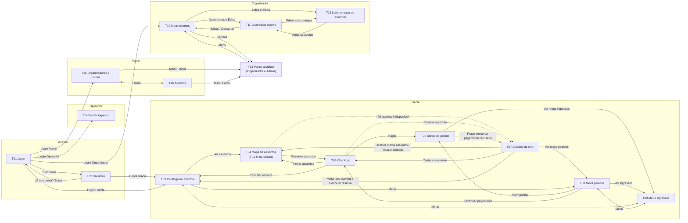
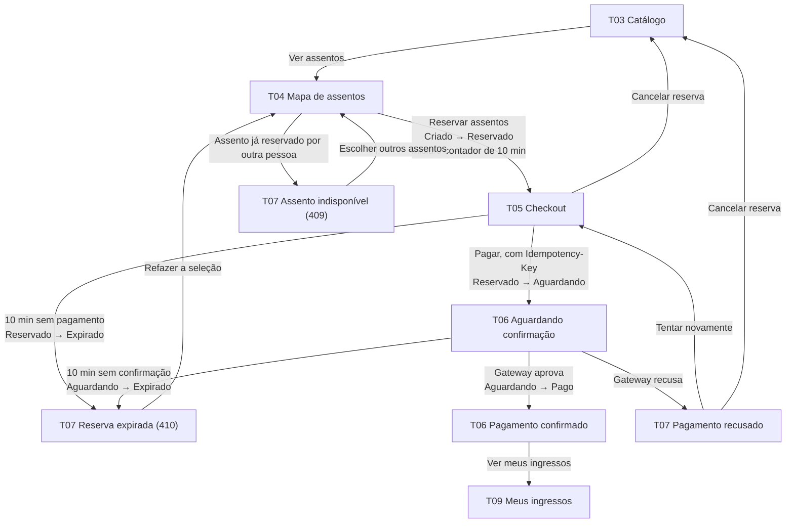

# PulsePass – Mockups e Mapa de Navegação

**PUCRS – Escola Politécnica | Construção de Software – 2026/2 | Projeto Integrador – Pacote 1**

**Grupo:** [Grupo 10] | **Integrantes:** [João Vitor Krampe], [Leticia Nunes], [Francine Delanni], [Luis Eduardo Trein], [Enzo Picoli]

**Versão:** 1.0 | **Data:** 13/10/2026 | **Status:** Rascunho para revisão do grupo

---

## 1. Introdução

Este documento mostra **como o front-end do PulsePass vai ser** antes de programá-lo: quais telas existem, como a pessoa navega entre elas e como cada tela se parece. Ele atende ao item "Mockups (low, medium ou high res, a escolha) e mapa de navegação do front-end" do Pacote 1 e se apoia nos documentos anteriores (Visão, Backlog e NFRs).

**Fidelidade escolhida: média (medium-fi).** Os mockups são wireframes em tons de cinza, com um único azul de destaque, textos reais em português e dados fictícios (NFR-LGP-02). Não definem identidade visual final, mas já mostram layout, conteúdo, estados e erros.

**Protótipo clicável.** Os 17 mockups estão num mesmo canvas ([abrir o canvas](https://claude.ai/artifact/UF1aPS2oNxmMttYZY1yXu5); o link é privado, então o dono precisa compartilhá-lo pelo menu "Compartilhar" antes da entrega). Os botões e links principais levam de uma tela à outra, na mesma ordem do mapa de navegação (seção 4). A única exceção é a T07, que não tem entrada por clique porque os erros dependem da resposta do servidor; ela fica aberta direto no canvas. Três telas têm interação de demonstração:

| Tela | O que dá para testar |
|---|---|
| T04 Mapa de assentos | Clicar em assentos livres para selecionar e desmarcar; o resumo e o total se atualizam |
| T06 Status do pedido | Botão "Simular confirmação" mostra o pedido passando de Aguardando para Pago |
| T14 Validar ingresso | Alternar o resultado da leitura: válido, já utilizado ou adulterado |

**Entrega.** Exportar cada tela do canvas (PNG ou PDF) para `/docs/05-mockups/` com os nomes da coluna "Arquivo" da seção 3, e anexar o PDF ao documento final do Pacote 1. [Anexar: exportação do canvas]

---

## 2. Perfis e página inicial

Depois do login, cada papel abre na sua própria página inicial (RBAC, US-05). O menu do cabeçalho muda conforme o papel, então ninguém vê links para telas que não pode acessar.

| Papel | Página inicial | Menu do cabeçalho |
|---|---|---|
| **Cliente** | T03 Catálogo de eventos | Eventos · Meus pedidos · Meus ingressos |
| **Organizador** | T10 Meus eventos | Meus eventos · Painel de vendas |
| **Operador** | T14 Validar ingresso | (tela única, com "Sair") |
| **Admin** | T15 Organizadores e contas | Painel · Organizadores e contas · Auditoria |

"Sair" aparece no cabeçalho de todas as telas autenticadas e leva a T01 (US-04).

---

## 3. Inventário de telas

| ID | Tela | Papel | Objetivo | Histórias | NFRs | Release | Arquivo |
|---|---|---|---|---|---|---|---|
| T01 | Login | Todos | Autenticar com e-mail e senha | US-02 | NFR-SEG-08 | R1 | `T01-login` |
| T02 | Cadastro | Visitante | Criar conta de Cliente | US-01 | NFR-SEG-06, NFR-LGP-01 | R1 | `T02-cadastro` |
| T03 | Catálogo de eventos | Cliente | Listar, buscar e filtrar eventos | US-11, US-42 | NFR-PER-01, NFR-USA-02 | R1 (filtros: R3) | `T03-catalogo` |
| T04 | Mapa de assentos | Cliente | Ver disponibilidade, escolher e reservar assentos | US-12, US-13 | NFR-PER-03, NFR-CON-02 | R1 | `T04-mapa-assentos` |
| T04-M | Mapa de assentos (celular) | Cliente | Mesma função em 390 px | US-12, US-13 | NFR-USA-02 | R1 | `T04m-mapa-assentos-celular` |
| T05 | Checkout | Cliente | Revisar o pedido e pagar dentro dos 10 min | US-18, US-20, US-21, US-15 | NFR-USA-01, NFR-IDP-01, NFR-LGP-01 | R1 (idempotência e cancelamento: R2) | `T05-checkout` |
| T06 | Status do pedido | Cliente | Acompanhar Aguardando → Pago em tempo real | US-21, US-29, US-27, US-28 | NFR-USA-01, NFR-USA-05, NFR-DIS-02, NFR-DIS-04 | R1 (tempo real: R2) | `T06-status-pedido` |
| T07 | Estados de erro | Cliente | Mensagens para falhas esperadas da compra | US-13, US-14, US-18, US-21 | NFR-USA-03, NFR-SEG-08 | R1–R2 | `T07-estados-erro` |
| T08 | Meus pedidos | Cliente | Listar pedidos, estados e histórico; cancelar | US-25, US-24, US-15 | NFR-SEG-11, NFR-USA-01 | R1 (cancelar: R2) | `T08-meus-pedidos` |
| T09 | Meus ingressos | Cliente | Ver ingressos, QR Code e baixar o PDF | US-30, US-27, US-28 | NFR-SEG-07, NFR-SEG-11, NFR-PER-04 | R2 | `T09-meus-ingressos` |
| T10 | Meus eventos | Organizador | Listar eventos próprios com status e ocupação | US-09, US-17 | NFR-SEG-11 | R1 (editar/cancelar: R2) | `T10-meus-eventos` |
| T11 | Criar/editar evento | Organizador | Dados do evento, situação e cancelamento | US-09, US-17 | NFR-SEG-02, NFR-SEG-10 | R1 (editar/cancelar: R2) | `T11-evento` |
| T12 | Lotes e mapa de assentos | Organizador | Definir setores, fileiras, assentos e preços | US-10 | NFR-SEG-10, NFR-USA-03 | R1 | `T12-lotes-mapa` |
| T13 | Painel analítico | Organizador e Admin | Métricas de vendas em tempo real | US-35, US-34 | NFR-OBS-03, NFR-SEG-11 | R3 | `T13-painel` |
| T14 | Validar ingresso (celular) | Operador | Ler o QR Code na entrada e consultar por código | US-31 | NFR-SEG-07, NFR-USA-02 | R3 | `T14-validar-ingresso` |
| T15 | Organizadores e contas | Admin | Gerir organizadores (abas) e contas de usuário | US-06, US-41, US-05 | NFR-SEG-02, NFR-SEG-05 | R2 (aba Contas: R3) | `T15-admin-organizadores` |
| T16 | Auditoria de credenciais | Admin | Consultar a trilha de acessos e mudanças de papel | US-07 | NFR-SEG-05, NFR-LGP-03 | R2 | `T16-auditoria` |

---

## 4. Mapa de navegação

### 4.1 Visão geral

Linhas tracejadas são desvios disparados pelo servidor (erro ou prazo vencido): fazem parte do mapa, mas não são clicáveis no protótipo. Os menus do cabeçalho aparecem como setas de duas pontas. A T13 está desenhada com o menu do Organizador; o Admin abre a mesma tela com o menu do Admin, que não foi desenhado.

### 4.2 Fluxo de compra e estados do pedido

Mostra a mesma jornada do comprador do Documento de Visão (seção 5.3), com a tela de cada passo e o estado do pedido (máquina de estados da US-19).

### 4.3 Estado do pedido e o que a pessoa vê

| Estado | Onde aparece | Contador de 10 min | Ações na tela |
|---|---|---|---|
| **Criado** | Transitório, entre T04 e T05 | Começa aqui | (nenhuma) |
| **Reservado** | T05, T08 | Sim | Pagar, Cancelar reserva, Alterar assentos |
| **Aguardando** | T06, T08 | Sim | Acompanhar, Cancelar pedido |
| **Pago** | T06 (confirmado), T08, T09 | Não | Ver meus ingressos, Baixar PDF |
| **Expirado** | T07 (reserva expirada), T08 | Não | Refazer a seleção |
| **Cancelado** (a decidir, ver seção 8) | T08 | Não | (nenhuma) |

---

## 5. Descrição das telas

### Acesso

**T01 · Login** (US-02)
- Campos de e-mail e senha, botão "Entrar" e link "Criar conta".
- Atalhos de demonstração para os quatro papéis (usuários do seed, NFR-REP-03). Não fazem parte do produto final.
- O erro de credenciais inválidas não foi desenhado na T01. Regra: mensagem genérica, sem dizer qual campo errou. A mensagem de excesso de tentativas está desenhada na T07 (NFR-SEG-08).

**T02 · Cadastro** (US-01)
- Nome, e-mail, senha e confirmação. Pede só o necessário (NFR-LGP-01).
- Sempre cria conta com papel Cliente. O link "Já tem conta? Entrar" volta à T01.
- O erro de e-mail já cadastrado (US-01) não foi desenhado. Regra: mensagem que não exponha dados de outras contas.

### Cliente

**T03 · Catálogo de eventos** (US-11, US-42)
- Busca por nome, filtro por cidade e data (filtros entram no R3).
- Cards com situação ("Vendas abertas", "Poucos lugares", "Esgotado"), data, local, assentos livres, ocupação e preço inicial. Evento esgotado não tem botão de compra.
- Lista paginada, servida de cache (NFR-PER-01).

**T04 · Mapa de assentos** (US-12, US-13) · versão celular **T04-M**
- Assentos por setor, com quatro estados distinguíveis por forma e texto, não só por cor: Livre, Reservado, Vendido e Selecionado.
- Resumo ao lado com assentos escolhidos, valor de cada um e total. Aviso: "ao reservar, os assentos ficam bloqueados por 10 minutos".
- Indicador de disponibilidade em tempo real (NFR-PER-03).
- "Reservar assentos" só fica ativo com ao menos um assento. A reserva é tudo ou nada (NFR-CON-02): se um dos assentos já foi reservado por outra pessoa, nenhum é bloqueado e a pessoa vê o erro 409 da T07.
- No celular, o mapa vira um trecho por vez (assentos 1 a 7, 8 a 14), com alvos de toque de 44 px e barra fixa com total e botão "Reservar".

**T05 · Checkout** (US-18, US-20, US-21, US-15)
- **Faixa de contador no topo** com o tempo restante em destaque e o horário do servidor (NFR-USA-01).
- Resumo do pedido (evento, assentos, total) e formulário de pagamento simulado. Aviso de que nenhum dado de cartão real é guardado.
- "Simulador do gateway" para a demonstração: aprovar, recusar ou lento (timeout).
- "Pagar" envia a requisição com Idempotency-Key. Texto de apoio: pode tentar de novo sem risco de cobrança duplicada.
- "Cancelar reserva" devolve os assentos e volta ao catálogo.

**T06 · Status do pedido** (US-21, US-29, US-27, US-28)
- Linha do tempo Criado → Reservado → Aguardando → Pago, com horários.
- Em **Aguardando**: contador, barra de progresso e indicação "Conectado em tempo real". Se a conexão cair, a tela reconecta e sincroniza (NFR-DIS-04); sem WebSocket, cai para consulta periódica (NFR-DIS-02). Nunca fica em branco (NFR-USA-05).
- Em **Pago**: faixa verde de confirmação, ingressos prontos, aviso de cópia por e-mail e botão "Ver meus ingressos".

**T07 · Estados de erro** (NFR-USA-03)
Quatro situações esperadas, cada uma com título, explicação e próxima ação:

| Situação | Mensagem principal | Ações |
|---|---|---|
| Assento indisponível (409) | Os assentos acabaram de ser reservados; nada foi bloqueado | Escolher outros assentos · Voltar aos eventos |
| Reserva expirada (410) | O prazo terminou, os assentos voltaram à venda e não houve cobrança | Refazer a seleção · Ver meus pedidos |
| Pagamento recusado | Seus assentos continuam reservados pelo tempo restante | Tentar novamente · Cancelar reserva |
| Limite de tentativas (429) | Aguarde antes de tentar de novo | Tentar de novo em N s (desativado) · Voltar ao login |

**T08 · Meus pedidos** (US-25, US-24, US-15)
- Lista só os pedidos da própria pessoa (NFR-SEG-11), com filtro por estado, valor, chip de estado e, quando há prazo, o tempo restante.
- Ações por estado: Acompanhar, Continuar pagamento, Cancelar pedido, Ver ingressos.
- Painel lateral com o histórico do pedido selecionado (estado e horário de cada transição).

**T09 · Meus ingressos** (US-30, US-27, US-28)
- Um cartão por ingresso: evento, data, local, assento, código e carimbo de tempo de emissão.
- QR Code assinado (NFR-SEG-07), botões "Baixar PDF" e "Abrir ingresso", e aviso da cópia enviada por e-mail.

### Organizador

**T10 · Meus eventos** (US-09, US-17)
- Eventos do próprio organizador, com status (Rascunho, Publicado, Cancelado) e ocupação.
- Ações: Editar, Lotes e mapa, Vendas. "Novo evento" abre a T11 vazia, em rascunho.

**T11 · Criar/editar evento** (US-09, US-17)
- Nome, descrição, data, horário, local, cidade e capa.
- Aviso quando o evento já tem vendas: o mapa não pode ser reduzido abaixo dos assentos vendidos.
- Quadro "Situação" com o que falta para publicar e a ação "Cancelar evento", que exige confirmação e gera tratamento dos pedidos afetados.

**T12 · Lotes e mapa de assentos** (US-10)
- Tabela de setores (nome, fileiras, assentos por fileira, preço) com a capacidade calculada.
- Mostra o erro de validação de assento duplicado: o setor "Camarote" repete as fileiras A e B da "Pista Premium". Enquanto houver conflito, "Salvar mapa" fica desativado.
- Pré-visualização do mapa, com todos os assentos Livres.

### Painel, Operador e Admin

**T13 · Painel analítico** (US-35, US-34)
- Indicadores (vendas por minuto, ingressos vendidos, conversão, reservas ativas), gráfico de vendas por minuto, ocupação por setor e últimos pedidos.
- Atualização a cada 5 s (NFR-OBS-03). O Organizador vê apenas seus eventos; o Admin vê todos (NFR-SEG-11).

**T14 · Validar ingresso** (US-31)
- Pensada para celular: seleção de evento e portão, área da câmera, cartão de resultado e campo de consulta por código.
- Três resultados, cada um com ícone, título e motivo: **Entrada liberada** (ingresso marcado como utilizado), **Ingresso já utilizado** e **QR Code inválido** (adulterado ou de outro evento).

**T15 · Organizadores e contas** (US-06, US-41)
- Aba Organizadores: botão "Novo organizador" e lista de ativos e suspensos, com Suspender, Reativar e Remover. Aba Contas de usuário: Bloquear e Desbloquear (R3).
- Toda ação é registrada na auditoria.

**T16 · Auditoria de credenciais** (US-07)
- Filtros por usuário, ação e período. Colunas: data e hora, usuário, ação, origem (IP) e resultado.
- Somente leitura: os registros não podem ser alterados (NFR-SEG-05).

---

## 6. Padrões de interface

### 6.1 Estados do assento

| Estado | Aparência | Clicável |
|---|---|---|
| Livre | Fundo branco, borda escura, número | Sim |
| Reservado | Fundo hachurado cinza | Não |
| Vendido | Fundo escuro com × | Não |
| Selecionado | Fundo azul com ✓ | Sim (desmarca) |

### 6.2 Chips de estado do pedido

| Estado | Cor do chip |
|---|---|
| Reservado | Azul claro |
| Aguardando | Âmbar |
| Pago | Verde |
| Expirado | Cinza |
| Cancelado | Vermelho claro |

Todo chip traz o nome do estado em texto, então a cor nunca é a única pista (NFR-USA-04).

### 6.3 Regras transversais

| Regra | Como aparece nos mockups | NFR |
|---|---|---|
| Contador visível da reserva | Faixa âmbar com mm:ss em T05 e T06 (enquanto Aguardando) e tempo restante nas linhas de T08. Em T04 há o aviso dos 10 min, pois a reserva ainda não existe. | NFR-USA-01 |
| Responsividade de 360 a 1920 px | Telas desktop fluidas (colunas empilham e menus quebram em linhas); T04-M e T14 desenhadas em 390 px | NFR-USA-02 |
| Erros claros com ação sugerida | T07, mais a validação inline da T12 | NFR-USA-03 |
| Acessibilidade básica | Campos com rótulo, botões reais, contraste mínimo 4,5:1, alvos de toque de 44 px no celular | NFR-USA-04 |
| Feedback durante picos | Estado "processando" na T06; sem tela em branco | NFR-USA-05 |
| Dados fictícios | Nomes, e-mails, IPs e eventos inventados | NFR-LGP-02 |

---

## 7. Rastreabilidade: Histórias → Telas

| História | Tela(s) | Observação |
|---|---|---|
| US-01 | T02 | |
| US-02 | T01, T07 | Login e mensagem de limite de tentativas |
| US-03 | — | Renovação transparente; se falhar, volta à T01 |
| US-04 | "Sair" no cabeçalho | Presente em todas as telas autenticadas |
| US-05 | Menus por papel | Cada papel só vê os próprios links; acesso indevido é tratado na seção 8 |
| US-06 | T15 | Aba Organizadores |
| US-07 | T16 | |
| US-09 | T10, T11 | |
| US-10 | T12 | |
| US-11 | T03 | |
| US-12 | T04, T04-M | |
| US-13 | T04, T04-M, T07 | Erro 409 |
| US-14 | T05, T06, T07, T08 | Contador e reserva expirada |
| US-15 | T05, T08 | Cancelar reserva |
| US-17 | T10, T11 | Editar e cancelar evento |
| US-18 | T05 | |
| US-19 | T06, T08 | Linha do tempo e chips de estado |
| US-20 | T05, T07 | Texto de apoio; o efeito é invisível quando funciona |
| US-21 | T05, T06, T07 | Pagamento, confirmação e recusa |
| US-24 | T08 | Cancelar pedido |
| US-25 | T08 | |
| US-27 | T06, T09 | PDF e QR Code |
| US-28 | T06, T09 | Aviso da cópia por e-mail |
| US-29 | T06 | Tempo real |
| US-30 | T09 | |
| US-31 | T14 | |
| US-35 | T13 | |
| US-41 | T15 | Aba Contas |
| US-42 | T03 | Filtros |
| US-08, 16, 22, 23, 26, 32, 33, 34, 36, 37, 38, 39, 40, 43 | — | Backend e infraestrutura, sem tela |

**Cobertura:** 28 das 43 histórias têm tela ou elemento de tela. As outras 15 são 14 histórias de backend, mensageria e DevOps mais a US-03, que é invisível quando funciona. A US-34 alimenta a T13, mas não tem tela própria.

---

## 8. Pontos em aberto para o grupo decidir

Ao desenhar as telas apareceram inconsistências entre os documentos. Cada uma precisa de uma decisão antes do Pacote 2.

| # | Ponto | Onde aparece | Sugestão |
|---|---|---|---|
| 1 | **Estado "Cancelado".** US-15 e US-24 falam em pedido cancelado, mas a máquina de estados (Visão 5.3, US-19 e o exemplo de `CLAUDE.md` em `01-processo-desenvolvimento.md`, seção 6.2) tem só Criado, Reservado, Aguardando, Pago e Expirado. | T08 mostra o chip "Cancelado" | Incluir o estado Cancelado na máquina e nos testes, ou tratar o cancelamento como Expirado |
| 2 | **Nova tentativa após recusa.** A Visão só permite Aguardando → Expirado. A T07 oferece "Tentar novamente" mantendo a reserva, o que exige a transição Aguardando → Reservado. A US-21 admite "nova tentativa ou Expirado". | T07, diagrama 4.2 | Decidir uma regra: recusa volta a Reservado (nova transição) ou leva direto a Expirado |
| 3 | **Download do PDF no R1.** A US-27 (PDF com QR Code) é R1, mas a US-30 (Meus ingressos) é R2, então o MVP não teria onde baixar o ingresso. | T06, T09 | Puxar a US-30 para o R1 ou pôr o botão de download direto na T06 |
| 4 | **Consulta do Operador.** A Visão (4.1) diz que o Operador consulta pedidos e ingressos, mas nenhuma história cobre isso. | Campo "Consultar por código" na T14 | Criar uma US adicional (próximo ID livre do backlog) ou tirar o campo |
| 5 | **Telas de sessão e acesso.** Não há mockup para "Acesso negado" (403) nem "Sessão expirada" (401). | US-03, US-05 | Redirecionar para a página inicial do papel (403) e para a T01 (401), com mensagem curta |

---

## 9. Como manter este documento

- Qualquer mudança em história, NFR ou estado do pedido deve atualizar o mockup e a tabela da seção 3 **no mesmo PR** (NFR-MAN-04).
- Ao criar uma tela nova, dar a ela um ID `Txx`, ligá-la a pelo menos uma US e incluí-la no mapa da seção 4.
- Os mockups são a referência visual do front-end; o agente Implementador deve receber o ID da tela junto com a spec da história (`/specs/stories/US-XX.md`).

---

## 10. Relação com os Demais Documentos

| Documento | Arquivo |
|---|---|
| Processo de Desenvolvimento com IA | `01-processo-desenvolvimento.md` |
| Documento de Visão | `02-visao.md` |
| Backlog (Story Mapping) | `03-backlog.md` |
| Requisitos Não-Funcionais | `04-requisitos-nao-funcionais.md` |
| Mockups e Mapa de Navegação | `05-mockups-mapa-navegacao.md` |
