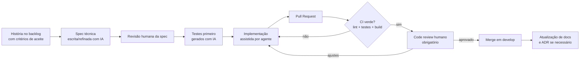

# PulsePass – Processo de Desenvolvimento Suportado por IA

**PUCRS – Escola Politécnica | Construção de Software – 2026/2 | Projeto Integrador – Pacote 1**

**Grupo:** [nome do grupo] | **Integrantes:** [nome 1], [nome 2], [nome 3], [nome 4], [nome 5]

**Versão:** 1.0 | **Data:** 12/10/2026 | **Status:** Rascunho para revisão do grupo

---

## 1. Introdução

Este documento descreve **como** o grupo desenvolve o PulsePass com apoio de Inteligência Artificial: o ciclo de desenvolvimento, as ferramentas e agentes utilizados, as especificações (specs) que guiam a IA e as regras de revisão humana. O objetivo é usar IA para acelerar o trabalho **sem abrir mão de rastreabilidade, qualidade e responsabilidade técnica do grupo**.

**Princípios do grupo:**

1. **Spec primeiro, código depois.** A IA recebe especificações claras e verificáveis; não "adivinha" requisitos.
2. **Humano responsável.** Toda saída da IA é revisada e aprovada por um integrante antes de entrar na branch `develop`.
3. **Testes como juiz.** O que a IA gera só é aceito se passar nos testes e no pipeline de CI.
4. **Tudo versionado.** Specs, prompts reutilizáveis, arquivos de contexto e decisões (ADRs) ficam no repositório.
5. **Transparência.** Usos relevantes de IA são registrados (evidências na seção 9).

---

## 2. Ciclo de Desenvolvimento

O grupo adota **Scrum adaptado** com elementos de Kanban, em sprints curtas alinhadas ao cronograma do Moodle.

| Elemento | Definição |
|---|---|
| **Duração da sprint** | 1 a 2 semanas (ajustar ao cronograma de entregas dos Pacotes 1 a 4) |
| **Planning** | Seleção de histórias do backlog (Story Map) e refinamento dos critérios de aceite; geração das specs da sprint |
| **Daily** | Assíncrona (chat) ou 15 min; impedimentos e uso de IA que gerou dúvidas |
| **Review** | Demonstração do incremento (walking skeleton → releases) |
| **Retrospectiva** | Inclui avaliação do uso de IA: o que funcionou, o que gerou retrabalho |
| **Quadro** | GitHub Projects / GitLab Boards com colunas: Backlog → Spec pronta → Em desenvolvimento → Em revisão → Em testes → Concluído |
| **Papéis** | Product Owner (rotativo), Scrum Master (rotativo), responsáveis por frente (IAM, Inventário, Checkout, Mensageria, Telemetria/DevOps) |

### 2.1 Fluxo de uma história de usuário (do backlog ao merge)



### 2.2 Definition of Ready (DoR)

Uma história só entra na sprint se tiver:

- [ ] Papel, ação e benefício claros.
- [ ] Critérios de aceite em formato Dado/Quando/Então.
- [ ] NFRs aplicáveis identificados (ver documento de NFRs).
- [ ] Contrato definido, quando houver (OpenAPI para REST, AsyncAPI/schema para eventos Kafka).
- [ ] Dependências entre serviços mapeadas.

### 2.3 Definition of Done (DoD)

- [ ] Critérios de aceite atendidos e demonstráveis.
- [ ] Testes unitários escritos (cobertura de domínio ≥ 70%) e testes de integração com Testcontainers quando envolver PostgreSQL, Kafka ou Redis.
- [ ] Pipeline de CI verde (linters, testes, build).
- [ ] Code review aprovado por pelo menos 1 integrante que **não** é o autor.
- [ ] Código gerado por IA revisado linha a linha pelo autor do PR.
- [ ] Documentação e contratos atualizados (OpenAPI/AsyncAPI, C4, README).
- [ ] Nenhum segredo, token ou dado pessoal no repositório.

---

## 3. Spec-Driven Development (SDD)

No SDD, a **especificação é o artefato central**; o código é derivado dela. A IA trabalha a partir de specs em camadas:

| Camada | Artefato | Onde fica | Quem produz | Papel da IA |
|---|---|---|---|---|
| 1. Intenção | Documento de Visão, Épicos | `/docs/02-visao` | Grupo | Apoia redação e revisão de consistência |
| 2. Requisitos | Histórias + critérios de aceite, NFRs | `/docs/03-backlog`, `/docs/04-nfr` | Grupo (PO da sprint) | Sugere critérios de borda, ambiguidades e casos de erro |
| 3. Contratos | OpenAPI (REST), AsyncAPI/JSON Schema (eventos Kafka) | `/specs/api`, `/specs/events` | Responsável da frente | Gera rascunho do contrato; humano valida |
| 4. Spec técnica da história | Arquivo `spec.md` por história (design, estados, SQL, tópicos, testes) | `/specs/stories/US-XX.md` | Autor da história | Gera rascunho a partir das camadas 1 a 3 |
| 5. Testes | Casos derivados dos critérios de aceite | `/src/**/test` | Autor + IA | Gera testes antes da implementação |
| 6. Código | Implementação | `/src` | IA assistida + autor | Implementa contra spec e testes |

### 3.1 Template de spec técnica por história

```markdown
# US-XX – <título>

## Contexto
<epic, serviço dono, dependências>

## Critérios de aceite (copiados do backlog)
- Dado ... quando ... então ...

## Contrato
- REST: <método, rota, request, response, erros, papéis permitidos>
- Eventos: <tópico, chave de partição, schema, produtor, consumidores>

## Modelo e estados
<tabelas/colunas, transições da máquina de estados, invariantes>

## Concorrência e consistência
<locks, constraints, transações, idempotência, outbox>

## NFRs aplicáveis
<ex.: NFR-CON-01, NFR-IDP-02>

## Plano de testes
- Unitários: ...
- Integração (Testcontainers): ...
- Casos de borda/falha: ...

## Fora de escopo
...
```

### 3.2 Exemplo de spec (trecho) – US-13 Reserva atômica de assentos

> **Entrada para a IA:** critérios de aceite da US-13, NFR-CON-01 (zero overselling), contrato `POST /events/{id}/reservations`, e a restrição "bloqueio via lock concorrente + devolução por TTL de 10 min".
>
> **Saída esperada (revisada por humano):** spec com a estratégia de alocação (ex.: `SET seat:{event}:{seat} {reservationId} NX EX 600` no Redis combinado a `UNIQUE (event_id, seat_id)` ativo no PostgreSQL), o fluxo de erro 409 para assento já reservado, evento `seat.reservation.created` / `seat.reservation.expired` e testes de concorrência (N threads disputando o mesmo assento → exatamente 1 sucesso).
>
> **Validação:** teste de integração com Testcontainers (Redis + PostgreSQL) executando 200 a 1.000 requisições simultâneas. O PR só é aprovado se o teste passar de forma estável.

---

## 4. Ferramentas e Agentes de IA

> Preencher com as ferramentas efetivamente usadas pelo grupo. A tabela abaixo é uma proposta inicial.

| Fase | Atividade | Ferramenta / Agente | Entrada | Saída | Controle humano |
|---|---|---|---|---|---|
| Requisitos | Rascunho de visão, épicos, histórias, NFRs | Claude (chat) | Enunciado, notas do grupo | Rascunhos de documentos | Revisão e ajuste coletivo |
| Requisitos | Revisão de consistência e rastreabilidade | Claude (chat) | Documentos 02 a 05 | Lista de lacunas e conflitos | Grupo decide o que acatar |
| Design | Rascunho de C4, modelo de dados, tópicos Kafka | Claude (chat) | Backlog, NFRs | Diagramas Mermaid/C4-PlantUML, ADRs | Revisão por arquiteto da sprint |
| Design | Contratos OpenAPI / AsyncAPI | Claude, Copilot | Spec da história | `openapi.yaml`, schemas | Validação com linter de contrato |
| Implementação | Geração e refatoração de código | Claude Code / Copilot / Cursor | Spec + testes + `CLAUDE.md` | Código em branch de feature | Revisão do autor + code review |
| Testes | Geração de testes unitários e de integração | Claude Code / Copilot | Critérios de aceite | Testes (JUnit/pytest/etc.) | Verificar se testes são significativos (não só cobertura) |
| Testes | Cenários de carga | Claude + k6/Gatling | NFRs de desempenho | Scripts de carga | Grupo ajusta metas |
| DevOps | Dockerfiles, `docker-compose.yml`, workflows de CI | Claude Code / Copilot | Requisitos de reprodutibilidade | Arquivos de infraestrutura | Executar do zero em máquina limpa |
| Revisão | Revisão automática de PR (segurança, estilo, bugs) | Assistente de review de PR | Diff do PR | Comentários | Revisor humano valida |
| Documentação | Atualização de docs a partir do código | Claude Code | Código + docs | Diffs de documentação | Revisão do autor |

> **Adaptar:** substitua ou remova ferramentas conforme o grupo (ex.: Gemini, ChatGPT, Cursor, Copilot) e registre a versão/modelo utilizado.

### 4.1 Agentes (papéis de IA)

Para organizar o uso, o grupo define "agentes" como **papéis com instruções fixas** (prompts de sistema reutilizáveis em `/ai/agents`):

| Agente | Responsabilidade | Restrições |
|---|---|---|
| **Analista de requisitos** | Transforma notas em histórias com critérios Dado/Quando/Então; aponta ambiguidades | Não inventa requisitos fora do enunciado |
| **Arquiteto** | Propõe decomposição em serviços, tópicos Kafka e modelo de dados; escreve ADRs | Toda decisão registra alternativas e trade-offs |
| **Implementador** | Implementa uma história a partir da spec e dos testes | Só altera arquivos do escopo da história; sem dependências novas sem aprovação |
| **Testador** | Deriva testes dos critérios de aceite, incluindo falha e concorrência | Testes devem falhar antes da implementação |
| **Revisor** | Revisa PR: segurança, idempotência, concorrência, aderência à spec | Aponta problemas; não faz merge |
| **Documentador** | Mantém C4, README e contratos sincronizados com o código | Não altera código de produção |

---

## 5. Fluxo Humano + IA e Responsabilidades

| Etapa | Humano | IA |
|---|---|---|
| Definir o que construir | Decide escopo, prioridades e critérios de aceite | Sugere cenários de borda e riscos |
| Especificar | Valida e assina a spec | Redige rascunho |
| Implementar | Orienta, revisa, corrige | Gera código dentro da spec |
| Testar | Garante que testes são relevantes | Gera casos e dados de teste |
| Revisar | Aprovação final (obrigatória) | Pré-revisão automática |
| Entregar | Merge e release | Nenhum merge automático |

**Regras de revisão:**

- O autor do PR é **responsável** pelo código, mesmo que gerado por IA.
- PRs com mais de ~400 linhas geradas por IA devem ser divididos.
- Alterações em segurança (IAM), concorrência (locks, constraints) e Outbox exigem **dois revisores**.
- Sugestões da IA que mudem a arquitetura exigem ADR aprovado antes.

---

## 6. Arquivos de Contexto e Prompts Reutilizáveis

### 6.1 Estrutura no repositório

```text
/
├── CLAUDE.md              # contexto e convenções para agentes (ou AGENTS.md)
├── /ai
│   ├── /agents            # prompts dos agentes (analista, arquiteto, ...)
│   ├── /prompts           # prompts reutilizáveis (gerar testes, revisar PR, ...)
│   └── /log               # registro de usos relevantes de IA (evidências)
├── /specs
│   ├── /api               # OpenAPI
│   ├── /events            # AsyncAPI / JSON Schema
│   └── /stories           # spec técnica por história
├── /docs                  # pacotes 1 e 2
├── /adr                   # decisões arquiteturais
└── docker-compose.yml
```

### 6.2 Exemplo de `CLAUDE.md` / `AGENTS.md`

```markdown
# PulsePass – Contexto para agentes

## Domínio
Plataforma de bilhetagem para megaeventos. Prioridades: zero overselling,
reserva com expiração de 10 minutos, checkout idempotente, emissão segura.

## Arquitetura
Microsserviços: iam (Keycloak/Cognito), inventory, orders, ticketing, analytics.
Dados: PostgreSQL (por serviço), Redis (locks, refresh tokens, cache), Kafka (eventos).

## Regras obrigatórias
- Nunca publicar no Kafka diretamente dentro de um caso de uso: usar Transactional Outbox.
- Todo consumidor Kafka deve ser idempotente (tabela de eventos processados).
- Endpoints de escrita de checkout exigem cabeçalho Idempotency-Key.
- Todas as rotas exigem JWT válido e checagem de papel (RBAC).
- Máquina de estados do pedido: Criado → Reservado → Aguardando → Pago | Expirado.
- Sem segredos no código; usar variáveis de ambiente.

## Processo
- Trabalhar apenas dentro do escopo da spec em /specs/stories.
- Escrever/atualizar testes junto com o código.
- Commits no padrão Conventional Commits.
- Não adicionar dependências sem justificar no PR.
```

### 6.3 Exemplos de prompts reutilizáveis

**Gerar testes a partir de critérios de aceite**

```text
Atue como o agente Testador. Dado o arquivo specs/stories/US-XX.md,
gere testes unitários para a máquina de estados e testes de integração
com Testcontainers (PostgreSQL, Redis, Kafka). Inclua casos de falha,
concorrência e reenvio idempotente. Os testes devem falhar antes da
implementação. Não implemente código de produção.
```

**Revisar PR**

```text
Atue como o agente Revisor. Analise o diff do PR em relação à spec
specs/stories/US-XX.md e ao CLAUDE.md. Aponte: violações de idempotência,
race conditions, escrita dupla (dual-write), falhas de autorização (RBAC),
vazamento de dados e testes insuficientes. Liste por severidade.
```

---

## 7. Gerenciamento da Configuração e IA (resumo)

O detalhamento do processo de GCS será entregue no Pacote 2. Resumo das regras que envolvem IA:

- Branches: `main` (releases), `develop` (integração), `feature/US-XX-descricao`.
- Commits que contenham código gerado por IA podem receber o trailer `Assisted-by: <ferramenta>` (opcional, mas recomendado).
- PR template inclui checklist: "Revisei o código gerado por IA", "Testes passam localmente", "Spec atualizada".
- CI executa linters, testes e build em todo PR e em merge na `develop`.

---

## 8. Riscos do Uso de IA e Mitigações

| Risco | Exemplo | Mitigação |
|---|---|---|
| **Alucinação** | API ou biblioteca inexistente; configuração Kafka incorreta | Compilar e testar; consultar documentação oficial; revisão humana |
| **Código plausível, porém errado** | Lock sem atomicidade que permite overselling | Testes de concorrência; revisão dupla em áreas críticas |
| **Vazamento de dados/segredos** | Colar chaves ou dados reais em prompts | Proibido enviar segredos; usar dados fictícios; `.env` fora do repositório |
| **Dependência excessiva** | Grupo não entende o que foi gerado | Autor deve explicar o PR; revisões com perguntas de entendimento |
| **Inconsistência entre artefatos** | Código diverge da spec ou da documentação | Atualizar spec/doc no mesmo PR; agente Documentador |
| **Licenças e plágio** | Trecho copiado de fonte com licença restritiva | Revisão de dependências; evitar colar grandes blocos sem entender a origem |
| **Segurança** | Sugestão com vulnerabilidades (ex.: validação JWT incompleta) | Revisão focada em segurança; análise estática no CI |

---

## 9. Evidências do Uso de IA

> Preencher ao longo do projeto (isso costuma pesar na avaliação). Sugestão de registro em `/ai/log`.

| Data | Integrante | Ferramenta/modelo | Objetivo | Prompt (resumo ou link) | Resultado | O que foi corrigido/descartado |
|---|---|---|---|---|---|---|
| 12/10/2026 | [nome] | Claude | Rascunho do Documento de Visão | Link/arquivo em `/ai/log/2026-10-12-visao.md` | Rascunho v1.0 | Metas numéricas ajustadas pelo grupo |
| | | | | | | |

**Métricas de acompanhamento (opcional):** nº de PRs com apoio de IA, retrabalho após revisão, bugs encontrados em código gerado, tempo economizado estimado.

---

## 10. Relação com os Demais Documentos

| Documento | Arquivo |
|---|---|
| Documento de Visão | `02-documento-visao.md` |
| Backlog (Story Mapping) | `03-backlog-story-mapping.md` |
| Requisitos Não-Funcionais | `04-requisitos-nao-funcionais.md` |
| Mockups e Mapa de Navegação | `05-mockups-mapa-navegacao.md` |