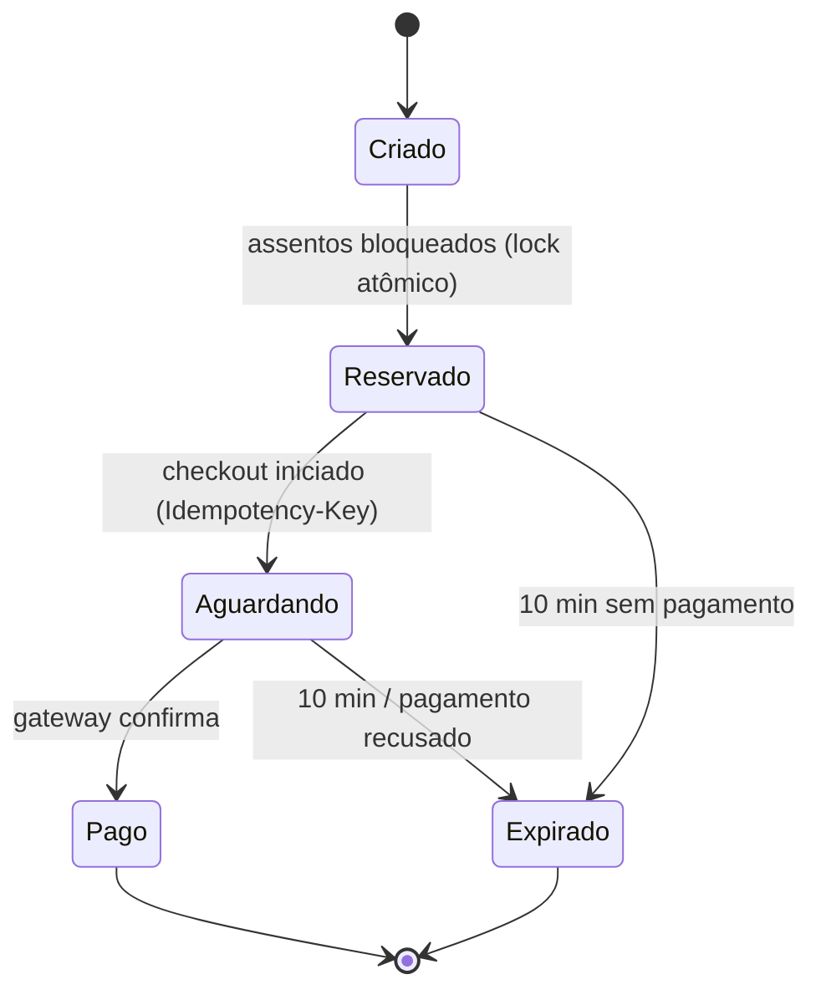

# PulsePass – Documento de Visão do Produto

**Plataforma Distribuída de Bilhetagem, Reserva e Acesso para Megaeventos**

**PUCRS – Escola Politécnica | Construção de Software – 2026/2 | Projeto Integrador – Pacote 1**

**Grupo:** [nome do grupo] | **Integrantes:** [nome 1], [nome 2], [nome 3], [nome 4], [nome 5]

**Versão:** 1.0 | **Data:** 12/10/2026 | **Status:** Rascunho para revisão do grupo

---

## 1. Introdução

### 1.1 Propósito

Este documento descreve a visão de alto nível do **PulsePass**: o problema que ele resolve, para quem, quais são seus objetivos mensuráveis, o que está dentro e fora do escopo e quais restrições e riscos cercam o projeto. Ele é a referência que orienta o backlog (épicos e histórias), os requisitos não-funcionais, os mockups e as decisões de arquitetura dos pacotes seguintes.

### 1.2 Sobre o nome

"PulsePass" é o nome de trabalho sugerido no enunciado. A metáfora do *pulso* remete ao pico de tráfego na abertura de vendas e o *pass* ao ingresso e ao acesso ao evento. Alternativas para votação do grupo: **TicketRush**, **GateFlow**, **Arena Pass**, **Rajada**. Caso o grupo escolha outro nome, basta substituí-lo neste documento.

### 1.3 Referências

- Enunciado do Projeto Integrador de Construção de Software – PUCRS, 2026/2.
- Cronograma da disciplina (Moodle).

---

## 2. Contexto e Problema

Megaeventos (shows, festivais, jogos, congressos) concentram a demanda de venda em poucos minutos: no instante da abertura, milhares ou milhões de pessoas disputam um número limitado de assentos. Esse padrão é conhecido como **flash crowd traffic**.

Sistemas de bilhetagem construídos de forma puramente síncrona (requisição HTTP que bloqueia até gravar no banco e responder) sofrem nesse cenário com:

- **Esgotamento de conexões de banco de dados**, pois cada requisição mantém uma conexão ocupada durante todo o processamento.
- **Acoplamento temporal**: se um componente (pagamento, e-mail, geração de PDF) fica lento ou cai, toda a cadeia é afetada.
- **Sobre-venda (overselling)**: duas pessoas compram o mesmo assento por falha de controle de concorrência.
- **Reservas "fantasma"**: assentos presos por compradores que desistiram, sem devolução ao estoque.
- **Inconsistência entre banco e mensageria** (*Dual-Write Dilemma*): o pedido é gravado, mas o evento não é publicado (ou o contrário), deixando ingressos sem emissão ou cobranças sem pedido.
- **Duplicidade de cobrança** por reenvio de requisições (retries, duplo clique, falhas de rede).

| Aspecto | Descrição |
|---|---|
| **O problema de** | vender ingressos de assentos limitados sob picos extremos de tráfego |
| **afeta** | compradores, organizadores de eventos e operadores de acesso |
| **cujo impacto é** | sobre-venda, perda de vendas por indisponibilidade, cobranças duplicadas, reservas que nunca expiram e ingressos não entregues |
| **Uma solução bem-sucedida** | garante zero overselling, expira reservas em 10 minutos, processa pagamentos de forma idempotente, emite ingressos de forma assíncrona e resiliente e oferece visibilidade em tempo real da operação |

---

## 3. Posicionamento do Produto

| Item | Declaração |
|---|---|
| **Para** | compradores de ingressos, organizadores e operadores de megaeventos |
| **Que** | precisam vender e comprar ingressos de assentos limitados em picos massivos de acesso, sem sobre-venda e sem perder pedidos |
| **O PulsePass é** | uma plataforma distribuída de bilhetagem, reserva e acesso baseada em microsserviços e eventos |
| **Que** | garante alocação atômica de assentos, reservas temporárias com expiração estrita de 10 minutos, checkout idempotente e emissão segura de ingressos em PDF com QR Code |
| **Diferente de** | sistemas monolíticos e puramente síncronos de venda de ingressos |
| **Nosso produto** | desacopla as etapas críticas via Kafka, usa o padrão Transactional Outbox para evitar escrita dupla, trata idempotência na API e no consumo de eventos e entrega telemetria em tempo real |

---

## 4. Partes Interessadas e Perfis de Usuário

### 4.1 Perfis de usuário (papéis RBAC)

| Perfil | Descrição | Principais necessidades |
|---|---|---|
| **Cliente (comprador)** | Pessoa que busca eventos, escolhe assentos e compra ingressos | Catálogo rápido, mapa de assentos confiável, reserva garantida por 10 minutos, pagamento seguro, receber o ingresso (PDF + QR Code) e acompanhar o status do pedido em tempo real |
| **Organizador** | Empresa ou pessoa responsável por um ou mais eventos | Criar eventos, lotes e mapas de assentos, acompanhar vendas e ocupação, ter garantia de que não haverá sobre-venda |
| **Operador** | Equipe de campo e suporte que atua no acesso ao evento e na operação | Validar ingressos (QR Code), consultar status de pedidos e ingressos, monitorar a operação |
| **Admin** | Administrador da plataforma | Gerenciar cadastro de organizadores, consultar trilha de auditoria de credenciais, acompanhar o painel analítico e a saúde da plataforma |

### 4.2 Outras partes interessadas

| Parte interessada | Interesse |
|---|---|
| Equipe de desenvolvimento (grupo) | Entregar um produto funcional, bem documentado e reprodutível |
| Professor(a) / avaliação da disciplina | Verificar domínio de arquitetura distribuída, mensageria, concorrência, testes, DevOps e uso crítico de IA |

### 4.3 Sistemas externos

| Sistema | Papel |
|---|---|
| Provedor de identidade (Keycloak ou Cognito) | Autenticação e emissão de tokens |
| Gateway financeiro (simulado) | Processamento de pagamentos |
| Serviço de envio de e-mail (simulado ou real) | Disparo de comprovantes e ingressos |

---

## 5. Visão Geral do Produto

### 5.1 Perspectiva

O PulsePass é uma plataforma composta por **microsserviços autônomos**, uma SPA (Single Page Application) e componentes de infraestrutura (PostgreSQL, Redis, cluster Kafka, servidores WebSocket), orquestrados por Docker Compose. A comunicação combina chamadas síncronas (leitura de catálogo, reserva de assentos) com **mensageria assíncrona** (confirmação de pagamento, emissão de ingressos, telemetria).

### 5.2 Frentes funcionais

| # | Frente | Responsabilidade | Capacidades principais |
|---|---|---|---|
| 1 | **Identidade e Governança (IAM)** | Segurança transversal | Autenticação stateless via JWT; refresh tokens em armazenamento chave-valor; RBAC com quatro papéis; auditoria de credenciais; gestão cadastral de organizadores |
| 2 | **Inventário e Concorrência** | Catálogo e assentos | Criação de lotes e mapas de assentos; catálogo de alta leitura; alocação atômica de assentos; devolução atômica em cancelamento ou timeout; publicação de eventos de expiração |
| 3 | **Transações e Checkout** | Pedidos e pagamentos | Máquina de estados do pedido (Criado, Reservado, Aguardando, Pago, Expirado); Idempotency-Key; Transactional Outbox; integração com gateway simulado |
| 4 | **Mensageria e Despacho** | Emissão e notificações | Consumo assíncrono de pagamentos confirmados; PDF com carimbo de tempo e QR Code; envio multicanal; atualização de tela em tempo real via WebSocket |
| 5 | **Análise e Operações** | Telemetria e DevOps | Ingestão e agregação contínua de eventos; painel de métricas em tempo real; CI/CD automatizada; ambiente via Docker Compose |

### 5.3 Fluxo principal (jornada do comprador)

1. O cliente se autentica e navega pelo catálogo de eventos.
2. Escolhe assentos no mapa; o sistema os bloqueia atomicamente e inicia um relógio de **10 minutos**.
3. O pedido passa a *Reservado* e o cliente segue para o checkout (com Idempotency-Key).
4. O pedido fica *Aguardando* a resposta do gateway; ao confirmar, passa a *Pago*. Se o prazo vence, passa a *Expirado* e os assentos voltam ao estoque.
5. O evento de pagamento confirmado é gravado via Outbox e publicado no Kafka.
6. O serviço de emissão consome o evento (de forma idempotente), gera o PDF com QR Code e notifica o cliente por e-mail e em tempo real na tela.
7. No dia do evento, o operador valida o QR Code na entrada.

---

## 6. Objetivos e Metas Mensuráveis

| ID | Objetivo | Meta / Critério de verificação |
|---|---|---|
| OBJ-01 | Eliminar sobre-venda | **0** assentos vendidos em duplicidade em teste de concorrência (ex.: 1.000 requisições simultâneas disputando o mesmo assento resultam em exatamente 1 reserva) |
| OBJ-02 | Expiração estrita de reservas | Reservas não pagas expiram em **10 minutos** e os assentos são devolvidos ao estoque atomicamente (tolerância a definir, ex.: ± 5 s) |
| OBJ-03 | Resiliência a picos | Suportar a rajada de abertura de vendas com meta inicial de **[X] req/s** de leitura de catálogo e **[Y] reservas/s**, verificada por teste de carga |
| OBJ-04 | Evitar escrita dupla | **100%** dos eventos de domínio de pedidos publicados via Transactional Outbox, sem perda mesmo com indisponibilidade temporária do Kafka |
| OBJ-05 | Idempotência | Reenvio de uma mesma Idempotency-Key não cria pedido ou cobrança duplicada; consumidores tratam mensagens repetidas sem efeito colateral duplicado |
| OBJ-06 | Segurança | Todas as rotas protegidas por JWT assinado e por RBAC; credenciais e eventos sensíveis auditados |
| OBJ-07 | Qualidade | Cobertura de testes unitários **≥ 70%** do domínio (máquinas de estado); testes de integração com Testcontainers (PostgreSQL, Kafka, Redis) |
| OBJ-08 | Reprodutibilidade | Ambiente completo sobe com um único `docker compose up` (backend, frontend, bancos, Kafka e UI de mensageria) |
| OBJ-09 | Observabilidade | Painel exibindo métricas de navegação e compras em tempo real |
| OBJ-10 | Governança de código | Pipeline de CI executa linters, testes e build a cada Pull Request e merge na branch `develop` |

> Os valores **[X]**, **[Y]** e **[Z]** devem ser definidos pelo grupo após estimar a capacidade do ambiente de teste.

---

## 7. Escopo

### 7.1 Dentro do escopo

- Cadastro, login, refresh de tokens e controle de acesso por papéis (Cliente, Organizador, Operador, Admin).
- Gestão de organizadores e auditoria de credenciais.
- Criação de eventos, lotes e mapas de assentos; catálogo de eventos.
- Reserva atômica de assentos, expiração em 10 minutos e devolução ao estoque.
- Pedidos com máquina de estados, checkout idempotente e gateway financeiro simulado.
- Transactional Outbox e publicação de eventos no Kafka.
- Emissão de ingressos em PDF com carimbo de tempo e QR Code.
- Notificações por e-mail e atualização em tempo real via WebSocket.
- Validação de ingressos por QR Code pelo operador.
- Ingestão de eventos de navegação e compras e painel analítico em tempo real.
- Pipeline de CI/CD, Docker Compose, testes automatizados e documentação (C4, processo com IA, GCS).

### 7.2 Fora do escopo

- Integração com gateways de pagamento reais e processamento financeiro real (será simulado).
- Reembolsos, estornos e conciliação contábil.
- Marketplace de revenda de ingressos entre usuários.
- Aplicativo móvel nativo (a interface é uma SPA responsiva).
- Precificação dinâmica e programas de fidelidade.
- Implantação em nuvem com orquestração avançada (ex.: Kubernetes) em produção.

> Itens do escopo podem ser reclassificados (MVP, Release 2, Release 3) no Story Mapping.

---

## 8. Restrições e Premissas

### 8.1 Restrições

| ID | Restrição |
|---|---|
| RES-01 | Estilo arquitetural baseado em **microsserviços** |
| RES-02 | Provedor de identidade externo: **Keycloak ou Cognito** |
| RES-03 | **Kafka** como plataforma de streaming de eventos |
| RES-04 | Tratamento explícito de **Dual-Write** (Outbox) e **idempotência no consumo** |
| RES-05 | Bancos relacionais (PostgreSQL) e chave-valor (Redis) |
| RES-06 | Orquestração do ambiente por **Docker Compose** |
| RES-07 | Pipeline de CI no **GitHub Actions ou GitLab** |
| RES-08 | Documentação arquitetural no **Modelo C4** (níveis 1 a 3) |
| RES-09 | Processo de desenvolvimento **suportado por IA** e documentado |
| RES-10 | Grupos de 3 a 5 pessoas; entregas conforme cronograma no Moodle |

### 8.2 Premissas

- O gateway financeiro e o envio de e-mail são simulados em ambiente de desenvolvimento.
- Cada assento pertence a um único evento/sessão e não pode ser vendido mais de uma vez.
- O tempo de reserva (10 minutos) é fixo e igual para todos os eventos.
- O ambiente de testes de carga é limitado ao hardware disponível ao grupo.

---

## 9. Riscos Principais

| ID | Risco | Prob. | Impacto | Mitigação |
|---|---|---|---|---|
| R-01 | Sobre-venda por condição de corrida na alocação de assentos | Média | Alto | Operações atômicas (locks no Redis e/ou restrições e transações no PostgreSQL); testes de concorrência automatizados |
| R-02 | Escrita dupla entre banco e Kafka | Alta | Alto | Transactional Outbox com worker de publicação e testes de falha com Testcontainers |
| R-03 | Processamento duplicado de mensagens | Alta | Médio | Consumidores idempotentes (tabela de eventos processados / chave de deduplicação) |
| R-04 | Contenção de locks em picos de abertura | Média | Alto | Reservas curtas com TTL, particionamento por evento, teste de carga |
| R-05 | Complexidade operacional (muitos contêineres) | Alta | Médio | Docker Compose único, perfis de execução, documentação de execução e *healthchecks* |
| R-06 | Estouro de prazo por escopo amplo | Alta | Alto | Story Mapping com MVP (walking skeleton), priorização MoSCoW, entregas incrementais |
| R-07 | Código gerado por IA com erros ou inconsistências | Média | Médio | Revisão humana obrigatória, specs claras, testes automatizados e *code review* |
| R-08 | Divergência entre documentação e código | Média | Médio | Atualização da documentação a cada pacote; ADRs; revisão cruzada |
| R-09 | Expiração de reserva falhar (timer perdido) | Média | Alto | Expiração garantida por TTL e por job de reconciliação; evento de expiração publicado no broker |
| R-10 | Distribuição desigual de trabalho no grupo | Média | Médio | Responsáveis por frente, revisão cruzada e acompanhamento no quadro do projeto |

---

## 10. Indicadores de Sucesso

| Indicador | Meta |
|---|---|
| Assentos vendidos em duplicidade | 0 |
| Pedidos duplicados por reenvio com mesma Idempotency-Key | 0 |
| Eventos perdidos entre banco e Kafka | 0 |
| Reservas expiradas devolvidas ao estoque dentro da tolerância | 100% |
| Cobertura de testes de domínio | ≥ 70% |
| Latência p95 de leitura do catálogo | < [Z] ms |
| Tempo para subir o ambiente completo | Um comando (`docker compose up`) |
| Builds de PR verdes na branch `develop` | 100% dos merges |

---

## 11. Glossário

| Termo | Definição |
|---|---|
| **Flash crowd** | Pico súbito e massivo de acessos em curto intervalo |
| **Overselling** | Venda do mesmo assento ou de mais ingressos do que o estoque disponível |
| **Lock concorrente** | Bloqueio que impede que dois clientes reservem o mesmo recurso simultaneamente |
| **Dual-Write** | Gravação em dois sistemas (ex.: banco e broker) sem atomicidade, gerando inconsistência |
| **Transactional Outbox** | Padrão em que o evento é gravado na mesma transação ACID do dado de negócio e publicado depois por um worker |
| **Idempotência** | Propriedade de uma operação que, repetida, produz o mesmo efeito de uma única execução |
| **Idempotency-Key** | Cabeçalho HTTP que identifica uma requisição de forma única para evitar duplicidade |
| **JWT** | JSON Web Token: token assinado usado em autenticação stateless |
| **RBAC** | Controle de acesso baseado em papéis |
| **IAM** | Gerenciamento de identidade e acesso |
| **C4** | Modelo de documentação arquitetural em quatro níveis (Contexto, Contêineres, Componentes, Código) |
| **Story Mapping** | Técnica de organização do backlog por jornada do usuário e releases |
| **MVP / Walking skeleton** | Menor versão funcional ponta a ponta do produto |

---

## 12. Próximos Passos

1. Revisão deste documento pelo grupo e definição do nome final e das metas numéricas ([X], [Y], [Z]).
2. Elaboração do backlog (épicos e histórias) em Story Mapping: `03-backlog-story-mapping.md`.
3. Detalhamento dos requisitos não-funcionais: `04-requisitos-nao-funcionais.md`.
4. Mockups e mapa de navegação: `05-mockups-mapa-navegacao.md`.
5. Processo de desenvolvimento suportado por IA: `01-processo-desenvolvimento-ia.md`.