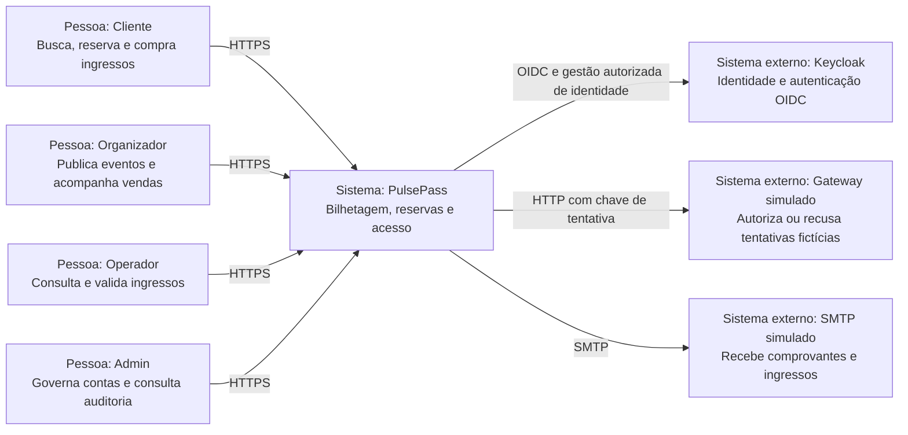
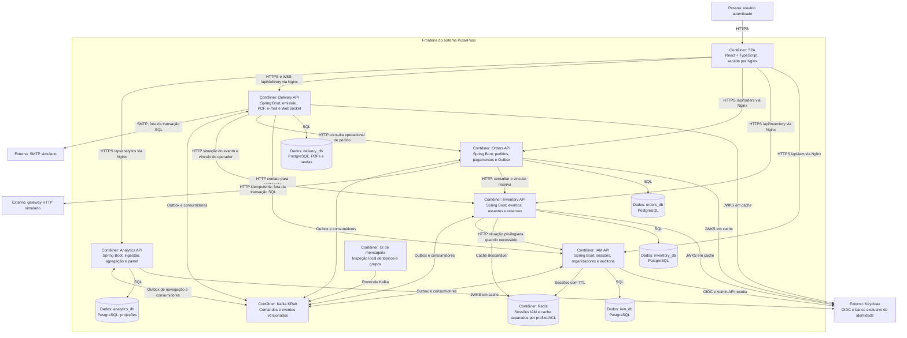
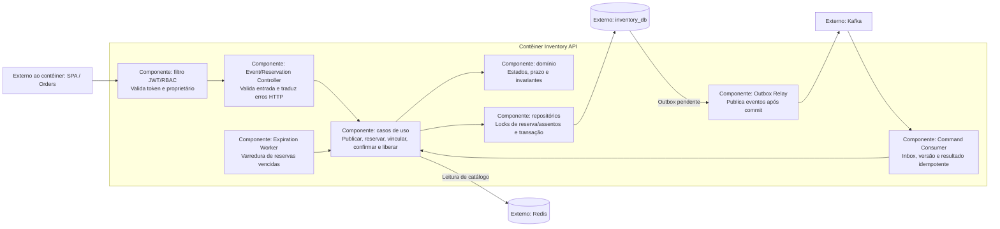
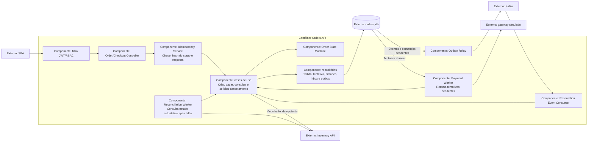
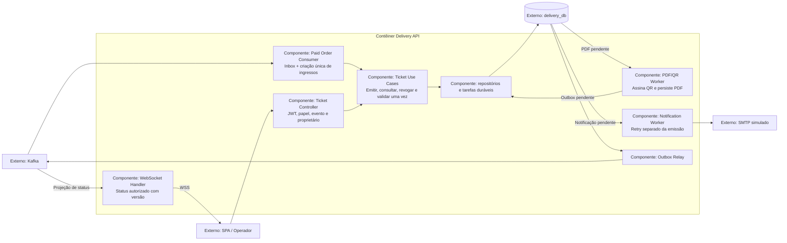
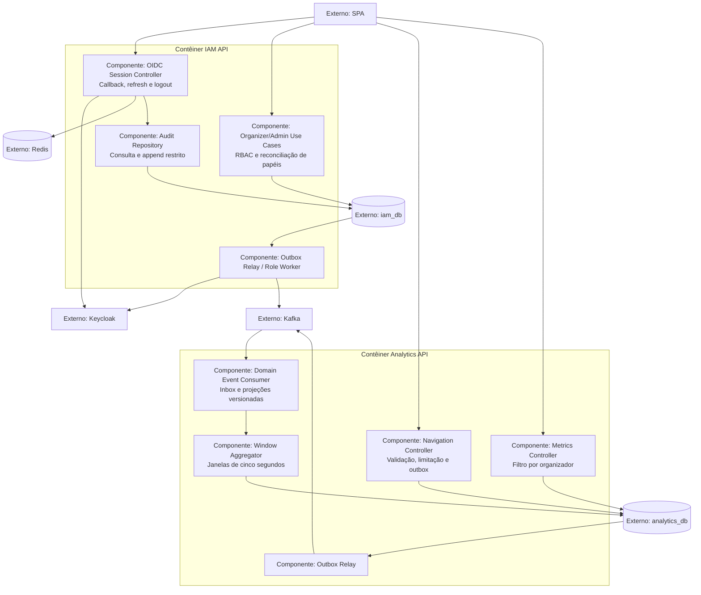
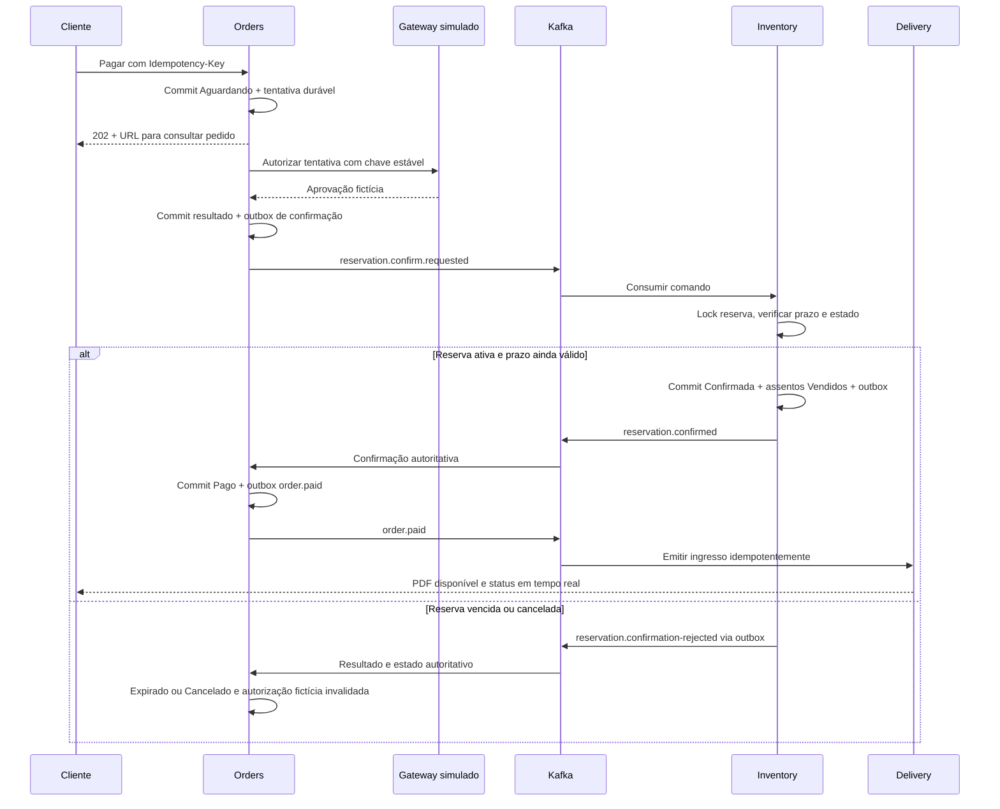
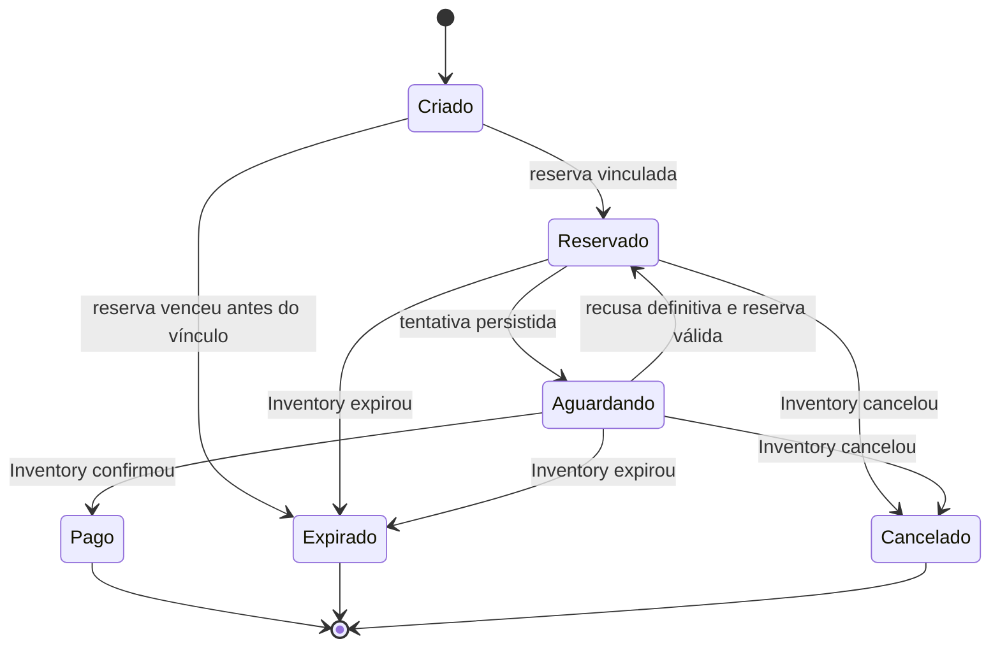

# PulsePass – Arquitetura de Software (C4)

**PUCRS – Construção de Software – 2026/2 | Grupo 10 | Pacote 2**

**Integrantes:** João Vitor Krampe, Leticia Nunes, Francine Delanni, Luis Eduardo Trein e Enzo Picoli.

**Versão:** 1.0 | **Data:** 19/10/2026 | **Status:** proposta arquitetural documentada para revisão do grupo.

## 1. Objetivo, escopo e decisões

Este documento descreve a arquitetura planejada, não uma aplicação já implementada. Atende aos níveis 1, 2 e 3 do C4 exigidos no enunciado. Os diagramas usam Mermaid com pessoas, sistemas, contêineres e componentes identificados por rótulos; são visões C4 expressas com a notação de fluxogramas, e não diagramas de classes.

O sistema deve impedir sobre-venda, limitar reservas a dez minutos, processar checkout idempotente e emitir ingressos assinados de forma assíncrona. As cinco frentes do enunciado orientam os serviços. A stack Java/Spring Boot e React/TypeScript foi escolhida nesta preparação com autorização do solicitante; as demais decisões são a proposta técnica deste pacote.

| Elemento | Escolha e justificativa |
|---|---|
| SPA | React + TypeScript; interface responsiva e verificação de tipos |
| Backend | Java 21 LTS + Spring Boot; APIs REST, segurança, transações e integração Kafka |
| Identidade | Keycloak; OIDC, assinatura de JWT e papéis centralizados |
| Dados | PostgreSQL; transações ACID e locks de linha para o inventário |
| Chave-valor | Redis; sessões de renovação e cache de catálogo, sem autoridade sobre assentos |
| Mensageria | Apache Kafka em modo KRaft; eventos assíncronos e grupos de consumidores |
| Ambiente | Docker Compose local; GitHub Actions para CI e publicação de artefatos de release |
| Artefatos | Maven Wrapper, lockfile npm, migrações Flyway e imagens com versão/digest fixados na implementação |

As versões exatas de bibliotecas e imagens serão fixadas ao criar os projetos, com compatibilidade verificada. Não se promete capacidade de produção com o ambiente local. Blockchain (US-43) permanece extensão opcional, fora da infraestrutura obrigatória do Pacote 2.

Alternativas consideradas: chamadas HTTP em toda a jornada aumentariam o acoplamento de emissão e e-mail ao checkout; locks Redis como única proteção exigiriam resolver atomicidade entre Redis e PostgreSQL. A proposta combina HTTP nas interações curtas e Kafka na propagação, com PostgreSQL como autoridade transacional do inventário.

## 2. C4 nível 1 – Contexto

Keycloak, gateway e SMTP são sistemas externos à lógica de negócio, mesmo quando executados no mesmo Compose. GitHub é ferramenta do desenvolvimento, não participante da compra. Os quatro papéis são obrigatórios; autorização por recurso complementa RBAC.

## 3. C4 nível 2 – Contêineres

Cada API é um processo implantável. Workers podem executar no mesmo processo de sua API nesta primeira versão; sua extração futura não muda a propriedade dos dados. Nginx encaminha `/api/*` e WSS, sem substituir a autorização feita por cada serviço. HTTP em rede interna isolada é permitido no ambiente local; acesso externo usa HTTPS/WSS em ambientes publicados.

| Serviço | Responsabilidade e dados exclusivos | Histórias principais |
|---|---|---|
| IAM | Organizadores, vínculo com `sub` do Keycloak, auditoria e sessões Redis; não armazena senhas | US-01 a 08, 41 |
| Inventory | Eventos, lotes, setores, assentos, reservas e vínculo reserva-pedido | US-09 a 17, 42 |
| Orders | Pedido, itens com preço congelado, tentativas de pagamento, histórico e idempotência | US-18 a 25 |
| Delivery | Ingressos, QR assinado, PDF, utilização, tarefas de notificação e projeção de status | US-26 a 32 |
| Analytics | Navegação, projeções de eventos/organizadores e métricas por janela | US-33 a 35 |

Um PostgreSQL local pode hospedar os cinco bancos, cada qual com usuário próprio e sem permissões cruzadas. Keycloak possui banco/usuário adicionais exclusivos. Não há joins, FKs ou consultas diretas entre bancos de serviços. Relações de negócio entre eles são referências por ID, snapshots e eventos.

## 4. C4 nível 3 – Componentes

### 4.1 Inventory API

### 4.2 Orders API

### 4.3 Delivery API

### 4.4 IAM API e Analytics API

## 5. Jornada e consistência entre serviços

### 5.1 Reserva e criação do pedido

1. O Cliente chama `POST /api/inventory/events/{id}/reservations` com assentos e chave idempotente. Inventory valida evento publicado, dono e preços; bloqueia as linhas dos assentos em ordem determinística, verifica disponibilidade de todos e grava reserva, ocupação e outbox na mesma transação. Retorna `201`, `reservationId`, `expiresAt` e horário do servidor; conflito retorna `409` sem reserva parcial.
2. Na entrada do checkout, a SPA chama `POST /api/orders` com `reservationId` e `Idempotency-Key`. Orders mantém `UNIQUE(reservationId)` e cria um pedido `Criado` com intenção durável de vinculação. O preço vem do snapshot do Inventory, nunca do corpo enviado pela SPA.
3. Orders solicita ao Inventory a vinculação idempotente da reserva ao `orderId`. Inventory, sob lock da reserva, verifica dono, prazo e vínculo único. A mesma vinculação retorna o resultado anterior; outro pedido é recusado. O resultado e `reservation.bound` são gravados com outbox. Orders passa a `Reservado` após confirmação. Um worker repete operações interrompidas; a reserva mantém seu prazo original.
4. Reserva abandonada antes de criar pedido também expira. Se a vinculação falhar por prazo, o pedido `Criado` passa a `Expirado`. Não há transação distribuída entre os dois bancos; estados intermediários e reconciliação fazem parte do fluxo.

### 5.2 Pagamento, expiração e cancelamento

O gateway é estritamente simulado: aprovação significa autorização fictícia, sem captura de dinheiro. Orders só publica `order.paid` após confirmação do Inventory. Uma integração financeira real exigiria projeto próprio de autorização/captura, compensações e conciliação, fora do escopo.

Inventory é a autoridade única sobre a reserva. Confirmar, expirar e cancelar usam lock da mesma reserva e dos respectivos assentos, sempre na mesma ordem. Operações de reservar/confirmar adquirem antes um lock compartilhado na linha do evento e verificam Publicado; cancelamento de evento usa lock exclusivo nessa linha para impedir novas vendas antes da limpeza em lotes. Assim, cancelamento de evento e confirmação têm ordem definida sem serializar todas as reservas entre si. O instante de decisão é obtido do relógio do PostgreSQL **depois** da aquisição dos locks, e não do início de uma transação que pode ter esperado. Se `agora >= expiresAt`, a confirmação é recusada. Uma operação de liberação só altera assentos ainda pertencentes àquela reserva; nunca apaga uma reserva mais nova.

O worker de expiração percorre o banco a cada segundo. A reserva perde validade lógica exatamente em `expiresAt`; liberar as linhas e publicar o evento pode levar até cinco segundos em operação normal. Uma nova reserva pode efetuar a limpeza transacional de ocupações vencidas. Redis TTL serve apenas de apoio, e sua perda não impede a expiração. Cache de catálogo usa TTL inicial de 1 s; mapa é consultado/pollado em até 2 s e disponibilidade exibida nunca substitui a validação da reserva. Indisponibilidade do banco reduz disponibilidade, sem relaxar a regra de venda.

Cancelar pedido é uma solicitação assíncrona (`202`) via `reservation.cancel.requested`. Orders só mostra `Cancelado` após o resultado autoritativo. Se confirmação já venceu a disputa, o cancelamento é recusado e o pedido converge para `Pago`. Nunca se libera assento de reserva `Confirmada`. Durante atraso Kafka a tela informa processamento; o contador zerado impede nova tentativa, mas não inventa um estado terminal local.

Recusa definitiva do gateway volta de `Aguardando` para `Reservado` enquanto houver prazo, permitindo nova tentativa. Timeout mantém a tentativa pendente: consultar/repetir com a mesma chave do gateway, sem iniciar outra cobrança fictícia. Se Inventory confirmar antes do prazo e o evento atrasar, Orders ainda pode receber `Pago` depois do contador zerar; o que vale é a decisão persistida no Inventory.

## 6. Estados e contratos de borda

`Cancelado` estende os cinco estados mínimos do enunciado para distinguir desistência de timeout. Não há cancelamento financeiro de pedido pago nesta máquina. Cancelamento de evento revoga ingresso e comunica o comprador, preservando o histórico de pagamento; estorno real está fora do escopo.

| Operação pública | Serviço | Papel e regra | Respostas principais |
|---|---|---|---|
| Listar eventos e mapa | Inventory | Cliente autenticado; demais papéis conforme necessidade operacional | 200; cache é informativo |
| Criar/configurar/publicar evento | Inventory | Organizador ativo e dono do evento | 201/200; 403; 422 |
| Reservar/cancelar reserva sem pedido | Inventory | Cliente dono; cancelamento com pedido passa pelo Orders | 201/200; 409; 410 |
| Criar pedido | Orders | Cliente dono da reserva; chave idempotente | 201 se concluído, 202 se pendente; 409; 410 |
| Pagar/cancelar pedido | Orders | Cliente dono; chave idempotente obrigatória | 202; 409 estado inválido; 422 chave reutilizada com corpo diferente |
| Consultar pedido | Orders | Cliente dono; consulta operacional usa permissão específica | 200; 404 para recurso não autorizado |
| Obter PDF | Delivery | Cliente dono; disponível na T06 desde R1 | 200; 202 enquanto gera; 404 |
| Validar/consultar ingresso | Delivery | Operador vinculado ao evento, ou Admin | 200 válido; 409 utilizado; 422 inválido |
| Gerir organizadores/auditoria | IAM | Admin | 200/201; 403 |
| Consultar painel | Analytics | Organizador vê seus eventos; Admin vê todos | 200; 403 |

Contratos OpenAPI completos serão derivados desta tabela na implementação. Todas as rotas protegidas retornam 401 para token inválido/ausente. Login, callback OIDC, recursos estáticos e healthcheck mínimo são exceções explícitas; catálogo autenticado mantém o escopo atual.

## 7. Identidade, autorização e observabilidade

- IAM realiza Authorization Code com PKCE e valida `state`, `nonce`, issuer e redirect URI. O login é hospedado pelo Keycloak; T01/T02 são referência visual a adaptar ao tema/fluxo do provedor.
- O refresh token fica cifrado no Redis, associado a sessão opaca em cookie HttpOnly/Secure/SameSite e TTL; a SPA mantém apenas access token em memória. Refresh/logout exigem proteção CSRF. Renovação é serializada por sessão para evitar reutilização concorrente; falha de atualização do Redis invalida a sessão e exige novo login. Logout remove a sessão e solicita revogação ao Keycloak.
- Cada API valida assinatura, `iss`, `aud`, validade e papéis, usando JWKS em cache. Access token dura até 15 minutos; revogar refresh não invalida magicamente access tokens já emitidos. Operações privilegiadas verificam também situação do organizador e vínculo ao evento; projeção desconhecida/desatualizada falha de forma fechada ou consulta IAM.
- Mudanças de papel entre IAM e Keycloak são reconciliadas por operação durável. A interface só declara concessão concluída após confirmação; suspensões negam operações privilegiadas durante pendência. Auditoria do Keycloak deve ser importada por listener/exportação confiável com deduplicação; chamadas de login que não passam pelo IAM também precisam ser registradas.
- QR contém identificador opaco, evento e versão de chave, assinado assimetricamente. Validação online faz atualização condicional de ingresso não utilizado. A SPA nunca recebe a chave privada.
- Logs JSON levam `correlationId`, serviço, ação e resultado, sem JWT, senha ou dados de cartão. Medir lag Kafka, idade da outbox, expirações atrasadas, throughput, erros e latência.
- WebSocket autoriza cada assinatura pelo dono do pedido, desconecta ao vencer credencial e não publica dados em canal global. Reconexão consulta o estado atual no Orders; polling é fallback. Redis Pub/Sub pode distribuir avisos entre réplicas do Delivery; perda de aviso é recuperada por consulta REST, não tratada como perda de evento de negócio.

## 8. Verificação prevista e rastreabilidade

| Risco/requisito | Decisão | Evidência a produzir na implementação |
|---|---|---|
| US-13; NFR-CON-01/02 | Locks e transação no Inventory | Mil requisições ao mesmo assento; um sucesso; lote tudo ou nada |
| US-14; NFR-CON-03/06 | Prazo persistido, worker e reconciliação | Limite exato, reinício e limpeza após recuperação |
| US-19/21/24 | Decisão única no Inventory | Corrida confirmar × expirar × cancelar em ambas as ordens |
| US-20 | Registro idempotente durável | Repetição simultânea, chave com outro corpo e timeout do gateway |
| US-22/23/26 | Outbox e inbox locais | Kafka indisponível, ack perdido e mensagem repetida |
| US-27/31 | QR assinado e uso condicional | QR alterado e duas validações simultâneas |
| US-05/25/35 | RBAC e propriedade | Tentativas de acesso entre clientes/organizadores |

Detalhes complementares: [modelo de dados](07-modelo-dados-conceitual.md), [Kafka](08-estrutura-mensageria-kafka.md), [pipeline](09-pipeline-desenvolvimento.md) e [GCS](10-processo-gcs.md).

## 9. Referências técnicas

- [C4 Model – níveis de diagramas](https://c4model.com/diagrams).
- [PostgreSQL – locks explícitos](https://www.postgresql.org/docs/current/explicit-locking.html).
- [Keycloak – aplicações OIDC](https://www.keycloak.org/securing-apps/oidc-layers).
- Enunciado do Projeto Integrador, páginas 3 e 4; [Visão](02-visao.md), [Backlog](03-backlog.md) e [NFRs](04-requisitos-nao-funcionais.md).
