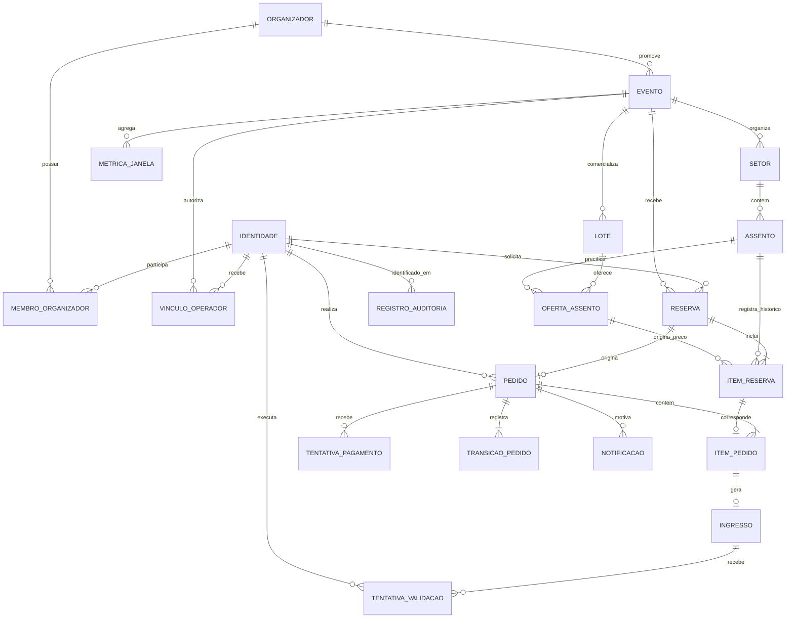

# PulsePass – Modelo de Dados Conceitual

**PUCRS – Construção de Software – 2026/2 | Grupo 10 | Pacote 2**

**Versão:** 1.0 | **Data:** 19/10/2026 | **Status:** modelo proposto para implementação e revisão do grupo.

## 1. Propósito e leitura

O modelo descreve conceitos do negócio, relacionamentos, cardinalidades e regras. A seção 5 complementa o modelo conceitual com requisitos lógicos de persistência; não substitui migrações SQL futuras. As relações entre serviços são referências por identificador, sem FKs ou joins entre bancos.

O usuário é identificado pelo `sub` emitido pelo Keycloak. Cliente, Organizador, Operador e Admin são papéis de uma identidade, não quatro cadastros com senhas próprias. Os atributos apresentados são os essenciais ao domínio, sem compromisso com nomes físicos de tabelas.

## 2. Diagrama conceitual integrado

`||` significa exatamente um, `o|` zero ou um, `o{` zero ou muitos e `|{` um ou muitos. Um evento em rascunho pode não ter setor/lote; publicação exige configuração completa. Um pedido possui itens e registro inicial de histórico na sua criação. `ITEM_RESERVA` registra histórico: múltiplas reservas podem referenciar o mesmo assento ao longo do tempo, mas só uma ocupação atual é permitida.

## 3. Catálogo de entidades e propriedade

| Entidade | Atributos conceituais essenciais | Serviço proprietário |
|---|---|---|
| Identidade | `subjectId`, nome, e-mail, papéis, situação | Keycloak; IAM mantém referências mínimas |
| Organizador | ID, nome, situação, data de criação | IAM |
| MembroOrganizador | Organizador, `subjectId`, função | IAM |
| RegistroAuditoria | ID, ator, ação, alvo, instante, origem, resultado | IAM |
| Evento | ID, organizador, nome, descrição, local, cidade, início, situação | Inventory |
| VinculoOperador | Evento, `subjectId`, portão/permissão, situação | Inventory; Delivery recebe projeção |
| Setor | ID, evento, nome | Inventory |
| Assento | ID, setor, fileira, número, estado atual, reserva ocupante | Inventory |
| Lote | ID, evento, nome, início/fim de venda, situação | Inventory |
| OfertaAssento | ID, lote, assento, preço, moeda | Inventory |
| Reserva | ID, evento, cliente, criação, expiração, estado, versão, pedido vinculado opcional | Inventory |
| ItemReserva | ID, reserva, assento, oferta, descrição e preço congelados | Inventory |
| Pedido | ID, reserva, cliente, organizador, evento, total, moeda, estado, versão | Orders |
| ItemPedido | ID, pedido, `itemReservaId`, assento, descrição e preço congelados | Orders |
| TentativaPagamento | ID, pedido, chave do gateway, resultado, horários, autorização fictícia | Orders |
| TransicaoPedido | ID, pedido, estado anterior/novo, motivo, instante, evento causador | Orders |
| Ingresso | ID, `itemPedidoId`, pedido, cliente, evento, assento, emissão, estado, chave de assinatura, PDF | Delivery |
| TentativaValidacao | ID, ingresso quando reconhecido, operador, evento, portão, instante, resultado | Delivery |
| Notificacao | ID, pedido, destinatário, canal, estado, tentativas, próxima execução | Delivery |
| MetricaJanela | Evento, início/fim da janela, vendas, valores, reservas, conversão e atualização | Analytics |

Ofertas separam localização física do preço comercial. Cada evento tem um mapa de assentos; lotes podem mudar o preço ao longo do tempo, mas não duplicam a capacidade física. Antes de publicar, Inventory rejeita ofertas simultâneas ambíguas para o mesmo assento. A reserva congela preço e moeda da oferta ativa.

Um ingresso adulterado que não permite reconhecer ID é registrado como tentativa inválida com referência de ingresso nula; não é criado um ingresso fictício. A relação no diagrama mostra as tentativas associadas a ingressos reconhecidos.

## 4. Regras do negócio

| ID | Regra |
|---|---|
| D-01 | Um evento pertence a um organizador; um usuário pode participar de mais de um organizador |
| D-02 | Um assento é único por evento, setor, fileira e número; fileira A em setores diferentes não é duplicidade |
| D-03 | Uma reserva contém pelo menos um assento, todos do mesmo evento; duplicatas na requisição são rejeitadas |
| D-04 | Reserva de vários assentos é tudo ou nada. Capacidade é o conjunto de assentos físicos, não a soma dos lotes |
| D-05 | `expiresAt = createdAt + 10 minutos`, definido pelo Inventory e não renovado por retry ou pagamento recusado |
| D-06 | Reserva só confirma se ainda ativa, vinculada ao pedido correto, com evento Publicado e válida no instante da decisão após os locks |
| D-07 | Reserva tem no máximo um pedido e pedido tem exatamente uma reserva; o vínculo é único nos dois serviços |
| D-08 | Total do pedido é a soma dos snapshots dos itens, em uma só moeda; alterações de preço não afetam reserva existente |
| D-09 | Um pedido pode ter várias tentativas de pagamento, mas no máximo uma pendente e uma conclusão de compra |
| D-10 | Um item de pedido gera no máximo um ingresso, mesmo se mensagens forem repetidas ou reprocessadas com outro ID |
| D-11 | Uso de ingresso é único. Duas leituras simultâneas só podem produzir uma entrada liberada |
| D-12 | Clientes só consultam seus pedidos/PDFs; organizadores só alteram seus eventos; operadores precisam de vínculo ao evento |
| D-13 | Eventos publicados exigem nome, local, horário, mapa e ofertas válidas. Após vendas, assentos vendidos não podem ser removidos |
| D-14 | Cancelamento de evento encerra novas vendas/reservas, libera reservas ativas e revoga ingressos; histórico financeiro é preservado |
| D-15 | Cancelar ou expirar só libera ocupação que ainda pertença àquela reserva; assento vendido não volta ao estoque por timeout |

### 4.1 Estados por entidade

| Entidade | Estados e transições |
|---|---|
| Evento | Rascunho → Publicado → Cancelado; rascunho também pode ser cancelado |
| Reserva | Ativa → Confirmada, Expirada ou Cancelada; terminais não retornam a Ativa |
| Assento | Livre → Reservado → Vendido; Reservado → Livre por expiração/cancelamento; selecionado é só estado visual |
| Pedido | Criado → Reservado → Aguardando → Pago; recusa definitiva permite Aguardando → Reservado; Criado pode expirar; Reservado/Aguardando podem expirar ou cancelar conforme Inventory |
| TentativaPagamento | Pendente → Autorizada, Recusada ou Invalidada; timeout mantém Pendente até resultado/reconciliação |
| Ingresso | Pendente → Emitido → Utilizado; Pendente/Emitido/Utilizado podem ser Revogados por cancelamento do evento, preservando histórico |
| Notificacao | Pendente → Enviada; falha temporária → Pendente com reagendamento; limite → Falha para análise |

Estado de ingresso `Pendente` significa registro criado sem PDF pronto. Download só é liberado em `Emitido` ou `Utilizado`, salvo política de revogação. Estado `Cancelado` do pedido é desistência antes de compra; cancelamento do evento não apaga nem reclassifica um pagamento concluído como se não tivesse existido.

## 5. Complemento lógico: persistência e consistência

### 5.1 Particionamento dos dados

| Banco/armazenamento | Conteúdo e política |
|---|---|
| `iam_db` | Organizadores, vínculos, operações de gestão de papéis, auditoria, inbox e outbox |
| Banco exclusivo Keycloak | Credenciais, papéis e dados internos do provedor; sem acesso SQL pelas APIs |
| `inventory_db` | Catálogo, ofertas, reservas, itens, estado atual dos assentos, inbox e outbox |
| `orders_db` | Pedidos, itens, histórico, tentativas, idempotência, inbox e outbox |
| `delivery_db` | Ingressos, bytes do PDF, tentativas de validação, notificações, projeções, inbox e outbox |
| `analytics_db` | Eventos de navegação recebidos, outbox, inbox, projeções e métricas |
| Redis | Refresh tokens cifrados com TTL de sessão e cache de catálogo com TTL curto; prefixos e permissões distintos |

Armazenar PDF no banco do Delivery simplifica o primeiro ambiente, evitando dual-write entre banco e arquivos. É uma escolha local com custo de espaço; armazenamento de objetos pode ser adotado depois com tarefa durável e consistência própria. Cache não guarda a única cópia de nenhum estado de reserva ou de compra.

### 5.2 Restrições e índices necessários

- IDs opacos UUID; datas persistidas em UTC e exibidas conforme fuso do evento. Valores monetários em centavos inteiros e moeda explícita; nunca ponto flutuante.
- Unicidade de `(evento, setor, fileira, número)`, `(lote, assento)`, `Pedido.reservaId`, vínculo reserva-pedido, `Ingresso.itemPedidoId`, chave de tentativa do gateway e chave de idempotência por usuário/operação.
- Inventory mantém a ocupação atual na linha de cada assento. Reservar bloqueia as linhas e atualiza todas na mesma transação; reservar/confirmar adquire antes lock compartilhado do evento, enquanto cancelar evento usa lock exclusivo. Confirmar/liberar bloqueia reservas envolvidas em ordem de ID e depois assentos em ordem de ID. Se encontrar ocupações vencidas, identifica/revalida essas reservas seguindo a mesma ordem; deadlock eventual exige retry limitado com a mesma chave.
- Índices por `Reserva(estado, expiresAt)`, `Pedido(cliente, criação)`, `Ingresso(cliente, evento)`, `outbox(status, próximaTentativa)` e `Notificacao(estado, próximaExecução)`.
- Restrições de estado/preço não negativo e unicidade de tentativa pendente por pedido. Atualização de estado usa lock/versão para não perder concorrência.
- Exclusão física de dados transacionais históricos não é operação do produto. Remover organizador equivale a desativar quando houver referências; conta removida é anonimizada conforme política, sem quebrar integridade histórica.

### 5.3 Estruturas técnicas (não entidades do negócio)

| Estrutura | Dados mínimos | Garantia |
|---|---|---|
| Outbox | `eventId`, agregado, versão, tipo, tópico, chave, payload, criação, estado, tentativas | Dado de domínio e intenção de publicação no mesmo commit |
| Inbox | consumidor, `eventId`, instante | `UNIQUE(consumidor,eventId)` na mesma transação do efeito local |
| Idempotência HTTP | usuário, operação, chave, hash canônico, estado, recurso, resposta | Distingue retry de outra intenção e retoma requisição interrompida |
| Operação do gateway | tentativa, chave estável, resultado, instante | Mesmo retry consulta/retorna a autorização fictícia anterior |
| Tarefa durável | ID, tipo, entidade, estado, tentativas, próxima execução | Recuperação de geração de PDF, e-mail e chamadas externas |
| Projeção de agregado | ID, proprietário, estado, versão aplicada | Descarta versão antiga e impede regressão por mensagem fora de ordem |
| Sessão Redis | ID opaco, usuário, refresh cifrado, expiração, versão | Renovação controlada e revogação da sessão local |

Idempotência HTTP retém resposta por 24 horas como parâmetro inicial. Após isso, unicidades de pedido/reserva e tentativa continuam impedindo duplicação de negócio. A mesma chave com outro corpo é erro 422; concorrência com a mesma chave retorna recurso/estado da operação em andamento. Deduplicação inbox acompanha a vida útil do agregado nesta versão; limpeza exige política que não permita reaplicar efeitos históricos.

### 5.4 Dados entre serviços

Orders copia evento, organizador, assentos, preços e prazo ao criar pedido. Delivery recebe em `order.paid` o snapshot necessário à emissão, incluindo cliente e referência autorizada de contato. Analytics mantém projeções de evento/organizador para filtrar o painel. A origem continua no serviço proprietário; projeções não autorizam alterações no dado original.

Uma mensagem pode chegar antes de existir o pedido local. O consumidor persiste a notificação pendente por `reservationId` e reaplica após a criação/vinculação ou reconcilia com Inventory. Versões de reserva e de pedido são sequências independentes. Não se compara versão de dois agregados diferentes.

## 6. Dados pessoais, auditoria e retenção

Somente nome e contato necessários à entrega são tratados; cartões e pagamentos são fictícios. JWT, refresh token, segredo e chave privada não entram em eventos/logs. Dados de auditoria são append-only para a identidade de aplicação, com consulta restrita ao Admin; isso não implica inviolabilidade contra administrador do banco. Backups e acesso operacional têm permissões separadas.

Parâmetros iniciais: logs técnicos e auditoria consultável por 90 dias; navegação bruta por sete dias; métricas agregadas durante o projeto; PDFs e registros transacionais durante o ciclo de demonstração. Prazos são escolhas do grupo para o ambiente acadêmico, não conclusão de conformidade legal. Ao encerrar o ambiente, dados fictícios podem ser descartados mediante procedimento de reset explicitamente executado.

Blockchain, se priorizada, terá estrutura de prova própria com hash/compromisso e estado de ancoragem; não altera as cardinalidades nem as garantias deste modelo, nem recebe dados pessoais, QR ou PDF.

## 7. Rastreabilidade e referências

| Área | Histórias | Requisitos relacionados |
|---|---|---|
| Identidade e organizadores | US-01 a 08, 41 | NFR-SEG-01 a 06, 11 |
| Eventos, ofertas e reservas | US-09 a 17, 42 | NFR-CON-01 a 06 |
| Pedidos e pagamentos | US-18 a 25 | NFR-IDP-01, NFR-RES-01/02 |
| Ingressos e notificações | US-26 a 32 | NFR-IDP-02, NFR-SEG-07 |
| Métricas | US-33 a 35 | NFR-OBS-03 |

Fontes do projeto: [Visão](02-visao.md), [Backlog](03-backlog.md), [Arquitetura C4](06-arquitetura-c4.md) e [Mensageria](08-estrutura-mensageria-kafka.md).
