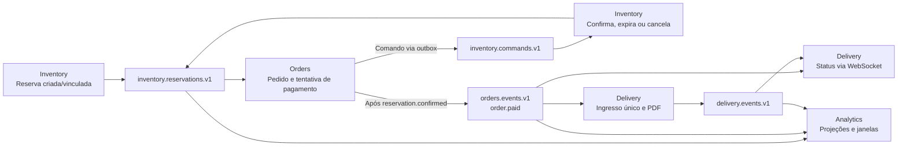

# PulsePass – Estrutura de Mensageria Kafka

**PUCRS – Construção de Software – 2026/2 | Grupo 10 | Pacote 2**

**Versão:** 1.0 | **Data:** 19/10/2026 | **Status:** contratos e topologia propostos; tópicos ainda não provisionados.

## 1. Objetivo e garantias

Kafka desacopla mudança de estado, emissão, notificações e análise. O sistema assume entrega **at-least-once**, com possibilidade de repetição. Consistência com PostgreSQL depende de outbox e consumidores idempotentes; configuração idempotente do produtor Kafka não torna atômica uma gravação no banco e no broker.

**Comando** solicita uma ação, que pode ser recusada. **Evento** relata um fato já persistido. Aprovação do gateway não é `order.paid`: este evento só existe após confirmação autoritativa dos assentos. Não há ordem global entre tópicos nem entre partições.

## 2. Tópicos e consumidores

Formato: `pulsepass.<dominio>.<fluxo>.v1`. Tipos de evento usam nomes como `reservation.confirmed`. Cada mensagem usa um ID de agregado como chave Kafka; IDs são opacos e não contêm e-mail/nome.

| Tópico | Tipos principais | Produtor | Grupos consumidores | Chave |
|---|---|---|---|---|
| `pulsepass.inventory.commands.v1` | `reservation.confirm.requested`, `reservation.cancel.requested` | Orders, via outbox | `inventory-commands-v1` | `reservationId` |
| `pulsepass.inventory.reservations.v1` | `reservation.created`, `.bound`, `.confirmed`, `.expired`, `.cancelled`, `.confirmation-rejected`, `.cancellation-rejected` | Inventory, via outbox | `orders-reservations-v1`, `analytics-reservations-v1` | `reservationId` |
| `pulsepass.inventory.events.v1` | `event.published`, `.updated`, `.cancelled`, `operator.assignment-changed` | Inventory, via outbox | `delivery-event-lifecycle-v1`, `analytics-catalog-v1` | `eventId` do evento de negócio |
| `pulsepass.orders.events.v1` | `order.created`, `.reserved`, `.awaiting-payment`, `.payment-declined`, `.paid`, `.expired`, `.cancelled` | Orders, via outbox | `delivery-ticket-issuer-v1`, `delivery-status-v1`, `analytics-orders-v1` | `orderId` |
| `pulsepass.delivery.events.v1` | `ticket.issued`, `.used`, `.revoked`, `notification.sent`, `.failed` | Delivery, via outbox | `delivery-status-tickets-v1`, `analytics-tickets-v1` | `orderId` |
| `pulsepass.iam.events.v1` | `organizer.activated`, `.suspended`, `identity.roles-changed` | IAM, via outbox | `inventory-governance-v1`, `analytics-governance-v1` | ID do organizador ou identidade do agregado |
| `pulsepass.analytics.navigation.v1` | `navigation.event-viewed`, `.checkout-opened` | Analytics API, via outbox de ingestão | `analytics-navigation-v1` | `sessionId` pseudônimo |

Grupos distintos recebem o mesmo evento independentemente. Dentro de um grupo, réplicas distribuem as partições entre si. Delivery separa emissão de ingresso e atualização de status para que um PDF lento não bloqueie o WebSocket. Tipos que não interessam a um consumidor são reconhecidos sem efeito, após validação do envelope.

O frontend envia navegação por HTTP ao Analytics; não acessa Kafka. Rejeição/falha de navegação não interrompe compra; o painel pode sinalizar métricas incompletas. Eventos de compra são duráveis nos serviços de negócio e não dependem dessa ingestão auxiliar.

### 2.1 Fluxo principal



## 3. Envelope e exemplo de contrato

Todos os horários são UTC em ISO 8601. O `eventId` do envelope identifica a mensagem; `payload.eventId` identifica o show/evento comercial. A diferença é obrigatória para evitar deduplicação por entidade errada.

```json
{
  "eventId": "74912496-b8c9-4fd9-9eab-61498a0e1bc1",
  "eventType": "order.paid",
  "schemaVersion": 1,
  "aggregateType": "order",
  "aggregateId": "36c38cf1-3875-4961-87f1-151c7c2a083c",
  "aggregateVersion": 4,
  "occurredAt": "2026-10-19T18:05:00Z",
  "producer": "orders",
  "correlationId": "5b982cf3-f89d-43a2-ab2e-6b1694ae2191",
  "causationId": "7d07aff0-599a-4803-a4a6-77bea584a3cd",
  "payload": {
    "orderId": "36c38cf1-3875-4961-87f1-151c7c2a083c",
    "reservationId": "59d8fe40-50a9-4c24-b1c4-96f872f37217",
    "customerId": "4fc1ce8d-acb6-49b8-9472-86ae32fc707f",
    "organizerId": "edec73a6-b878-4c1b-8728-f2de2e90c138",
    "eventId": "45b8ef9b-e3b8-4184-b62a-4053bdf1c0a8",
    "eventName": "Festival Pulse – Demonstração",
    "eventStartsAt": "2026-11-28T22:00:00Z",
    "venue": "Arena de Demonstração",
    "currency": "BRL",
    "totalCents": 15000,
    "items": [
      {
        "orderItemId": "ba1d0a8e-84c9-45ed-b9ad-2ddf91645ac0",
        "seatId": "c61c1d27-a788-41ef-b118-a8eb40ea612b",
        "sector": "Pista Premium",
        "row": "A",
        "number": "12",
        "priceCents": 15000
      }
    ]
  }
}
```

O exemplo contém dados fictícios e não inclui destino de e-mail. Delivery obtém contato por consulta autenticada e restrita ao IAM quando prepara a notificação, persistindo a tarefa antes de enviá-la. Isso evita espalhar e-mail em todos os consumidores do tópico de pedidos. A indisponibilidade do IAM adia o e-mail e não impede a emissão.

| Mensagem | Payload mínimo além do envelope |
|---|---|
| `reservation.confirm.requested` | `reservationId`, `orderId`, `paymentAttemptId`, autorização fictícia, `commandId` |
| `reservation.cancel.requested` | `reservationId`, `orderId`, motivo, `commandId` |
| `reservation.created` / `.bound` | Reserva, evento, cliente, prazo, assentos/preços; `.bound` inclui pedido |
| `reservation.confirmed` | Reserva, pedido, instante da decisão, tentativa, versão da reserva |
| `reservation.expired` / `.cancelled` | Reserva, pedido se existente, estado final, instante e motivo |
| `reservation.confirmation-rejected` / `.cancellation-rejected` | `commandId`, reserva, pedido, motivo e snapshot autoritativo do estado/versão |
| `event.cancelled` | Evento, organizador, versão, instante e motivo |
| `ticket.issued` | Ingresso, pedido, item, evento e instante; sem bytes do PDF ou QR completo |

Rejeição de comando não precisa alterar a versão do agregado; inclui a versão observada e ID do comando. Não é descartada como projeção antiga antes de concluir a operação correspondente. `causationId` relaciona o resultado ao comando; logs propagam `correlationId`.

## 4. Publicação com Transactional Outbox

1. O caso de uso atualiza o agregado e insere mensagem na outbox **na mesma transação PostgreSQL**. Se houver rollback, nenhum dos dois permanece.
2. Relay busca pendências, obtém lease/lock de publicação por agregado e publica na sequência local de outbox daquele agregado. Réplicas não podem publicar versão posterior enquanto a anterior continua pendente. Usar apenas `SKIP LOCKED` em linhas independentes não garante essa ordem.
3. Produtor usa `acks=all` e `enable.idempotence=true`. A configuração exata respeita as exigências de compatibilidade do cliente Kafka escolhido.
4. Somente após o ack o relay marca a linha como enviada. Falha antes disso mantém pendência. Falha após ack e antes da marcação pode duplicar publicação, o que é esperado.
5. Mensagens publicadas mantêm `eventId` original em cada retry. Não recriar ID a cada envio. Monitorar idade da pendência, tentativas e tamanho da outbox.

Outbox não realiza transação ACID entre serviços. Cada serviço tem sua própria transação e suas compensações/reconciliações. Falha de Kafka mantém pedidos em processamento; Inventory continua respeitando o prazo de expiração pelo banco.

## 5. Consumo, ordem e idempotência

- Consumidor valida envelope e schema. Abre transação local, insere inbox com chave `(consumer,eventId)`, aplica a regra e grava efeitos/tarefas/outbox. Commit local ocorre antes do commit de offset Kafka.
- Duplicata com inbox concluída não reaplica efeito. Unicidade de `ticket.orderItemId` protege também contra reprocessamento que use um novo ID de mensagem.
- PDFs, SMTP, gateway e publicação Kafka não executam dentro da transação do consumidor. O commit registra tarefas duráveis; workers externos às transações fazem as chamadas e persistem resultado.
- Versão do agregado impede regressão de projeções. Inbox, agregado e versão aplicada são atualizados atomicamente. Lacuna de versão é retida para reconciliação, não ignorada como se nada tivesse acontecido.
- Pedidos não se tornam `Expirado` apenas porque o relógio da tela zerou. A decisão do Inventory vence atraso/reordenação. Uma `reservation.confirmed` válida atrasada ainda conclui o pedido; um snapshot de terminal incompatível exige reconciliação e alerta, não transição arbitrária.
- Se evento de reserva chegar antes da criação do pedido, Orders guarda pendência por reserva e a reaplica após vínculo ou consulta o Inventory.
- Para cancelamento de evento e emissão em tópicos diferentes, Delivery persiste projeção do evento cancelado e revoga ingressos existentes. Se `order.paid` chegar depois, cria ingresso já revogado/sem disponibilizar PDF. Antes de liberar validação, confirma que o evento está ativo e que o operador tem vínculo; projeção sem atualização confiável exige consulta ao Inventory ou recusa temporária.

### 5.1 Retry e DLQ

Política inicial: uma tentativa imediata e até três retries, com esperas de 1, 5 e 30 segundos. Durante o retry, pausar a partição e continuar heartbeats/poll adequados ao cliente, sem bloquear outras partições. Erro de negócio definitivo gera resultado de recusa; não vai para DLQ como falha técnica.

Após o limite, falha técnica ou schema irrecuperável registra no banco local uma pendência de análise, bloqueio daquele agregado e uma outbox para `pulsepass.dlq.<grupo-consumidor>`. Depois do commit local pode avançar o offset; o relay publica a DLQ. Se o banco local estiver indisponível, **não** avançar offset. A DLQ contém mensagem original, tópico/partição/offset, grupo, tentativas e erro sanitizado, sem stack trace com segredos.

Eventos posteriores do agregado bloqueado são guardados como adiados, sem produzir efeitos de negócio; outros agregados podem continuar. Correção e replay preservam o ID original e a sequência, liberando o bloqueio após sucesso/reconciliação. Inbox de sucesso não é gravada para mensagem que falhou. Replay é ação autorizada e auditada; não ocorre automaticamente ao abrir a UI Kafka.

## 6. Configuração inicial do ambiente

| Parâmetro | Ambiente local acadêmico | Justificativa/limite |
|---|---|---|
| Brokers/controladores | Um nó combinado KRaft | Reduz consumo local; sem alta disponibilidade |
| Partições | Três por tópico de domínio/comando; três para navegação | Paralelismo inicial, sem alegar dimensionamento de produção |
| Réplicas | Uma, `min.insync.replicas=1` | Broker único; `acks=all` não protege contra perda de disco desse nó |
| Retenção domínio/comandos | Sete dias, política `delete` | Janela de recuperação local; outbox e dados operacionais não dependem só dela |
| Retenção navegação | Um dia no Kafka; sete dias no banco bruto | Volume auxiliar e minimização |
| Retenção DLQ | Quatorze dias, com alertas e registro local durável | Nenhuma pendência deve ser perdida por expiração silenciosa |
| Autocriação de tópicos | Desabilitada; inicializador explícito | Nomes/partições/configuração reproduzíveis |
| Offset | Commit manual após persistência local | Evita reconhecer efeito antes do commit |
| Publicação | Outbox em cada serviço; retries até recuperar | Alvo inicial: drenar em até 30 s após recuperação sob carga nominal |

O Compose futuro inclui volume Kafka, healthcheck e UI local. Fora do ambiente isolado, configurar TLS/SASL e ACL por produtor/grupo; restringir UI administrativa. Réplicas e partições de um ambiente maior exigem medição; três brokers com replicação três e ISR mínimo dois seriam uma configuração distinta a avaliar, não característica do Compose local.

## 7. Evolução, observação e critérios de aceite

JSON Schema será versionado em `specs/events/` na implementação. Campos opcionais com defaults podem evoluir compativelmente; remover/renomear obrigatório ou mudar semântica exige nova versão e migração coordenada de produtores/consumidores. Um tópico `v2` não substitui o `v1` até os consumidores estarem migrados.

| Cenário a automatizar | Resultado esperado |
|---|---|
| Kafka cai depois do commit SQL | Outbox permanece; evento publicado após recuperação |
| Ack se perde e relay repete | Um efeito local; ingresso único por item |
| Serviço cai após commit local e antes do offset | Reentrega sem efeito duplicado |
| Confirmar concorre com expirar/cancelar | Um estado autoritativo e nenhum assento vendido duas vezes |
| Evento de pedido chega antes do cancelamento do evento, ou depois | Ingressos convergem para revogados e acesso é negado |
| Mensagem inválida atinge limite | DLQ por consumidor, agregado bloqueado e replay auditável |
| Dois consumidores do mesmo grupo | Partições distribuídas sem duplicação do efeito de negócio |

Métricas: consumer lag, taxa de erro, DLQ pendente, idade de outbox, tempo pagamento→PDF e reservas vencidas ainda não limpas. Painel de negócio não substitui alertas técnicos.

## 8. Referências

- [Apache Kafka – design e semântica de entrega](https://kafka.apache.org/41/design/design/) (referência conceitual consultada; versão de execução será fixada na implementação).
- [Arquitetura C4](06-arquitetura-c4.md), [Modelo de dados](07-modelo-dados-conceitual.md) e [Pipeline](09-pipeline-desenvolvimento.md).
- US-16, 22, 23, 26, 32 a 35; NFR-IDP-02, NFR-RES-01 a 06 e NFR-MAN-05.
