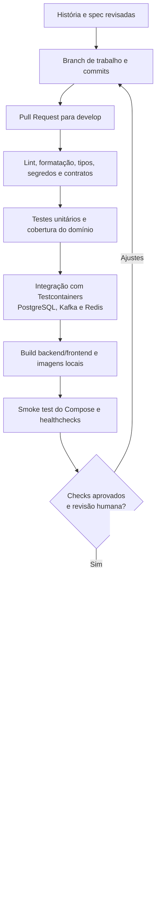

# PulsePass – Pipeline de Desenvolvimento e Infraestrutura

## Estado executável — 15/11/2026

O workflow [.github/workflows/ci.yml](../.github/workflows/ci.yml) implementa PRs e pushes em `develop`, com permissões `contents: read`, Actions fixadas por SHA e jobs backend/frontend/Compose. Backend executa Checkstyle, JUnit, JaCoCo, Failsafe/Testcontainers e package; frontend executa ESLint, TypeScript, Vitest e Vite. Compose tem smoke com OIDC real/PDF, logs em falha e parada preservando volumes. Os relatórios são retidos por14dias.

Comandos reais:

```sh
cd backend
./mvnw -B -ntp verify
cd ../frontend
npm ci
npm run lint
npm run typecheck
npm run test:ci
npm run build
cd ..
docker compose config --quiet
docker compose up --build -d --wait --wait-timeout 300
python3 scripts/smoke.py
```

JaCoCo exige70% de linhas nos pacotes de domínio e aplicação dos serviços de negócio, incluindo os casos de uso do Delivery. Não há exclusão das regras relevantes para satisfazer o percentual. `.mvn/jvm.config` fixa API Docker1.44 para compatibilidade Testcontainers/Docker29. As integrações não são silenciosamente ignoradas sem Docker.

Execução local final e limitações estão em [11](11-checkpoint-pacote-3.md). Workflow versionado não é evidência de execução remota nem de bloqueio de merge. Publicação de imagens/release e proteções de branches permanecem etapas futuras. As seções seguintes preservam o planejamento original do Pacote2; itens não listados acima não são presumidos implementados.

**PUCRS – Construção de Software – 2026/2 | Grupo 10 | Pacote 2**

**Versão:** 1.0 | **Data:** 19/10/2026 | **Status:** especificação da pipeline e do ambiente futuro.

## 1. Objetivo e situação atual

Este documento atende à descrição esquemática da pipeline pedida no Pacote 2. Define como validar Java/Spring Boot, React/TypeScript, contratos e infraestrutura. Nesta entrega documental não existem projetos executáveis, workflows GitHub Actions nem Compose funcional; os comandos abaixo são o contrato da implementação futura, não instruções que já funcionam no checkout atual.

**Incremento após a preparação do Pacote 2:** `backend/orders` inicia somente o domínio da US-19, com testes unitários e Maven Wrapper. Esse incremento ainda não implementa API, CI, cobertura JaCoCo, integração ou Compose; a pipeline completa abaixo continua sendo o plano de desenvolvimento.

Ferramentas propostas: GitHub Actions, Maven Wrapper, JUnit, JaCoCo, Testcontainers, ESLint, TypeScript e testes de frontend. Testes de carga são bônus do enunciado. A cobertura obrigatória é de pelo menos 70% do domínio backend, incluindo máquinas de estado; não se promete esse percentual sem relatório.

## 2. Visão esquemática



Publicação de release é a entrega contínua prevista. Não há implantação automática em nuvem no escopo. Execução no ambiente de demonstração é operação separada, após obter configuração e segredos apropriados.

## 3. Eventos, etapas e critérios

| Evento/etapa | Trabalho previsto | Condição de aprovação e artefatos |
|---|---|---|
| PR para `develop` ou `main` | Executar validação na revisão exata proposta para merge | Checks do commit atual, sem reaproveitar sucesso de outro commit |
| Push em `develop` e `main` | Repetir validação após integração | Relatórios e build correspondentes ao SHA integrado |
| Qualidade estática | Java: Checkstyle/formatador; frontend: ESLint e `tsc`; Markdown/links; secret scanning | Zero erros; não expor valores de possíveis segredos no log |
| Contratos | Validar OpenAPI, JSON Schema/AsyncAPI e exemplos | Contratos sintaticamente válidos; incompatibilidades deliberadas exigem versão e revisão |
| Testes unitários | Domínio, estados, autorização e componentes frontend | Todos passam; relatório JUnit e JaCoCo por serviço |
| Cobertura | JaCoCo com pacotes de domínio explícitos | Cada serviço com domínio de negócio atinge ≥70%; não excluir regras para aumentar índice |
| Integração | Testcontainers com PostgreSQL/Kafka e Redis quando envolvido | Dados isolados, dependências reais e todos os cenários críticos aprovados |
| Build | JARs, bundle React e imagens locais | Compilação e empacotamento de todos os serviços |
| Smoke Compose | Subir stack, aplicar migrações/seed e executar jornada mínima | Serviços saudáveis; compra simulada produz um PDF; teardown mesmo em falha |
| Tag `vMAJOR.MINOR.PATCH` | Validar origem da tag em `main`, revalidar e publicar imagens | Imagens vinculadas ao SHA/digest, notas de release e relatórios |
| Carga manual/agendada | k6 ou equivalente, ambiente controlado | Relatório p95/p99, throughput, erros e zero overselling; bônus separado do gate básico |

Mesmo PR somente documental executa lint/links e validação Mermaid. Quando houver aplicação, checks obrigatórios de código podem usar detecção de mudanças, mas o job final precisa verificar os resultados esperados, evitando check obrigatório silenciosamente ausente. O primeiro workflow de documentação não deve fingir que executa testes de aplicação inexistente.

## 4. Pirâmide de testes e cenários essenciais

| Camada | Cenários mínimos |
|---|---|
| Unitários | Transições válidas/inválidas, total do pedido, prazo, recusa definitiva versus timeout, verificação de QR e política por papel/recurso |
| Integração Inventory | Mil requisições ao mesmo assento, reserva de lote tudo ou nada, disputa confirmar × cancelar × expirar, prazo após espera por lock e liberação após reinício |
| Integração Orders/Kafka | Atomicidade outbox, Kafka indisponível/recuperado, ack perdido, inbox duplicada, vinculação interrompida e resultado de reserva anterior ao pedido |
| Integração Delivery | Um ingresso por item, retomada de PDF, e-mail falhando sem bloquear emissão, validação concorrente e cancelamento de evento antes/depois de `order.paid` |
| Integração IAM | Renovação, logout, rotação concorrente, token inválido, mudança de papel pendente e isolamento entre organizadores |
| E2E/smoke | Login, catálogo, reserva, pagamento fictício, download pela T06, expiração e acesso negado |

Testes de tempo usam relógio controlável nos casos de uso e testes específicos do relógio autoritativo no PostgreSQL. Não esperar dez minutos em todos os testes. Testcontainers sobe instâncias reais; mocks do broker não substituem o teste de integração exigido. Testes E2E podem ser poucos e focados, sem inverter a pirâmide.

## 5. Organização futura e comandos contratados

```text
backend/                  # Maven agregador dos cinco serviços
  pom.xml
  mvnw
  iam/ inventory/ orders/ delivery/ analytics/
frontend/                 # React + TypeScript, package-lock.json
specs/api/                # contratos HTTP
specs/events/             # eventos versionados
infra/                    # inicialização Kafka, Keycloak e bancos
docker-compose.yml
.github/workflows/        # implementação futura dos checks e release
docs/                     # documentação e rastreabilidade
```

| Diretório futuro | Comando planejado | Responsabilidade |
|---|---|---|
| `backend/` | `./mvnw -B verify` | Lint, unitários, JaCoCo e integração com Failsafe; profile e convenções fixados nos POMs |
| `frontend/` | `npm ci` | Instalar versões do lockfile |
| `frontend/` | `npm run lint` e `npm run typecheck` | Estilo e tipos |
| `frontend/` | `npm run test:ci` e `npm run build` | Testes sem modo watch e bundle |
| Raiz | `docker compose config --quiet` | Validar configuração resolvida sem imprimir segredos |
| Raiz | `docker compose up --build --wait` | Subir ambiente com healthchecks e inicializadores |
| Raiz | `docker compose down` | Encerrar preservando volumes; reset destrutivo deve ser explícito |

Esses caminhos e scripts serão criados com a aplicação. O README atual não deve apresentar esses comandos como disponíveis antes disso.

## 6. Infraestrutura de demonstração

| Componente | Configuração planejada |
|---|---|
| Frontend e APIs | Imagens separadas, rotas Nginx e rede interna; `/health` mínimo e readiness por dependência |
| PostgreSQL | Bancos/usuários exclusivos por serviço e Keycloak; volume persistente; migrações Flyway por proprietário |
| Redis | Volume/configuração de sessões, isolamento por prefixo/ACL e cache recuperável; perda de sessões exige novo login |
| Kafka | Nó KRaft local, volume, inicializador explícito de tópicos e UI de mensageria |
| Keycloak | Realm importável com papéis e usuários fictícios; migração/configuração versionadas, sem segredos reais |
| Gateway | Simulador com aprovar/recusar/timeout e resultado idempotente por tentativa |
| SMTP | Caixa de e-mail de demonstração, sem envio real obrigatório |
| Seed | Organizador, evento publicado, assentos/ofertas e quatro perfis fictícios; reexecução não duplica dados |

Healthchecks de infraestrutura usam comandos próprios de cada produto; não se exige `/health` HTTP de todo banco/broker. `depends_on` coordena startup, mas aplicações ainda precisam de retry e recuperação após falhas em execução. Readiness pode sinalizar Kafka indisponível para processamento enquanto liveness permanece positiva; não criar ciclo de reinício que impeça recuperar outbox.

## 7. Reprodutibilidade e segurança da CI

- Runner Linux com Docker disponível para Testcontainers. Jobs de unidade e frontend podem rodar em paralelo; smoke depende do build. Limites de tempo e cleanup obrigatório evitam recursos abandonados.
- Java 21, Node LTS compatível, Maven Wrapper, lockfile npm e versões/digests de imagens são fixados na implementação. Cache acelera dependências; não substitui `npm ci` nem artefatos do SHA atual.
- Permissão padrão de workflow `contents: read`. Somente job de release recebe permissão de publicar pacotes; PRs de forks não recebem segredos nem permissão de escrita.
- Executar código de PR com `pull_request`, sem usar `pull_request_target` para rodar conteúdo não confiável com privilégios. Actions externas terão revisão e SHA fixado.
- Segredos via armazenamento apropriado do GitHub; `.env.example` contém nomes e valores fictícios. Nunca imprimir configuração com credenciais nos relatórios.
- Relatórios JUnit, JaCoCo, lint, contratos e smoke retidos inicialmente por 14 dias; release mantém notas, SHA e digests. Evidência deve ser real, não screenshot de execução anterior sem associação ao commit.

## 8. Sequência de implementação posterior

1. Criar skeleton Java/React, wrappers/lockfiles e testes mínimos significativos.
2. Ativar lint, unidade, cobertura e build sem jobs fictícios.
3. Adicionar bancos, Kafka, Redis, Keycloak e simuladores com Compose e inicialização idempotente.
4. Adicionar integração Testcontainers e smoke ponta a ponta.
5. Configurar proteções de branches e release conforme [GCS](10-processo-gcs.md).

Nenhuma dessas execuções é declarada concluída pelo presente documento. Os Pacotes 3 e 4 deverão anexar evidências do estágio real e manter esta especificação atualizada.

## 9. Referências

- [GitHub Actions – funcionamento de workflows e jobs](https://docs.github.com/en/actions/get-started/understand-github-actions).
- [Testcontainers para Java](https://java.testcontainers.org/).
- [Arquitetura C4](06-arquitetura-c4.md), [Kafka](08-estrutura-mensageria-kafka.md), [Processo de desenvolvimento](01-processo-desenvolvimento.md) e [NFRs](04-requisitos-nao-funcionais.md).
