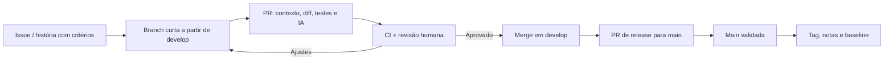

# PulsePass – Gerenciamento da Configuração de Software (GCS)

**PUCRS – Construção de Software – 2026/2 | Grupo 10 | Pacote 2**

**Versão:** 1.0 | **Data:** 19/10/2026 | **Status:** processo proposto para adoção pelo grupo.

## 1. Objetivo e ferramentas

GCS mantém código, documentação, contratos e infraestrutura identificados, revisados e recuperáveis ao longo das quatro entregas. O repositório remoto identificado no checkout é [FrancineDelanni/TF-Construcao-de-Software](https://github.com/FrancineDelanni/TF-Construcao-de-Software). Git é o controle de versão e GitHub é a plataforma proposta para PRs, issues, quadro e Actions.

As regras abaixo descrevem o processo a adotar. Proteções, permissões, quadros e checks remotos não foram inspecionados/configurados nesta preparação; não se afirma que estejam ativos. Este documento detalha o resumo de GCS da seção 7 do [processo de desenvolvimento](01-processo-desenvolvimento.md).

## 2. Itens de configuração

| Item | Controle e identificação |
|---|---|
| Visão, backlog, NFRs, mockups e Pacote 2 | Markdown/HTML/imagens no Git; versão e data nos documentos |
| Código e testes | Diretórios de backend/frontend, commits e PRs ligados a US |
| Contratos HTTP/eventos | OpenAPI e schemas versionados; compatibilidade revisada |
| Dados e migrações | Flyway por serviço; migrações aplicadas não são reescritas |
| Ambiente | Compose, Dockerfiles, realm de teste, tópicos Kafka e seeds |
| Dependências | Maven Wrapper, versões Maven, lockfile npm e imagens fixadas |
| Pipeline | Workflows e configuração de lint/teste/cobertura |
| Decisões e uso de IA | Justificativas nas seções de decisões e registros de assistência; ADR específico quando necessário |
| Releases | Tag anotada, SHA, notas, relatórios e digests de imagens |

Não versionar `.env` real, tokens, senhas, chaves privadas, dados pessoais reais, volumes de banco, caches, `node_modules`, JARs/bundles gerados ou arquivos locais de ferramenta sem propósito compartilhado. `.env.example` e seeds contêm apenas dados fictícios. O `.gitignore` será ampliado ao criar os projetos; a presença da regra escrita não garante ausência de segredo no histórico.

## 3. Branches e fluxo de trabalho

Adota-se um fluxo simples com `main` e `develop`, preservando o processo já previsto no Pacote 1. Branches de trabalho são curtas e integram por PR. `release/*` só é criada se houver necessidade de estabilização em paralelo; não é etapa obrigatória a cada mudança.

| Branch | Finalidade | Origem e destino |
|---|---|---|
| `main` | Linha de versões entregáveis | Recebe PR de `develop` ou correção urgente |
| `develop` | Integração validada das histórias | Recebe PRs de trabalho |
| `feature/US-13-reserva-atomica` | Implementar história | Sai de `develop`, retorna por PR |
| `fix/US-21-timeout-gateway` | Corrigir defeito | Sai de `develop`, retorna por PR |
| `docs/pacote-2-arquitetura` | Alterar documentação | Sai de `develop`, retorna por PR |
| `chore/ci-testcontainers` | Ferramentas e infraestrutura | Sai de `develop`, retorna por PR |
| `hotfix/ingresso-duplicado` | Corrigir falha de versão entregue | Sai de `main`, PR para `main` e sincronização posterior com `develop` |

Antes de iniciar, atualizar a base e consultar branches existentes para evitar trabalho duplicado. Não renomear branch remota nem criar proteção silenciosamente como parte da documentação. Conflitos são resolvidos pelo autor com validação posterior; resolver um conflito não dispensa repetir os checks afetados.

## 4. Commits e Pull Requests

Commits usam `tipo(escopo): descrição`, com tipos `feat`, `fix`, `docs`, `test`, `refactor` e `chore`. Exemplos: `feat(inventory): reserva atomica de assentos` e `docs(arquitetura): descreve fluxo de expiracao`. Referenciar US/issue no corpo; usar `Closes #N` somente quando a issue realmente estiver concluída. Alteração incompatível deve indicar impacto e migração.

O PR deve conter:

- Problema/história e comportamento resultante, incluindo critérios de aceite.
- Mudanças de dados, contratos e infraestrutura e sua estratégia de compatibilidade.
- Evidências reais de testes/checks e limitações conhecidas.
- Documentação atualizada e instrução para reproduzir quando aplicável.
- Ferramenta de IA usada, contribuição relevante e correções humanas; sem inventar revisão concluída.
- Plano de rollback para mudanças de risco ou release.

### 4.1 Revisão e regras de integração

| Mudança | Revisão necessária | Verificação adicional |
|---|---|---|
| Comum | Pelo menos um integrante que não é autor | Critérios de aceite e CI |
| IAM, concorrência, outbox/idempotência | Dois revisores humanos distintos do autor | Cenários de falha e invariantes |
| Arquitetura/contrato incompatível | Revisão dos responsáveis dos serviços afetados; registrar decisão | Migração e impacto nas specs |
| Apenas documentação | Um revisor | Links, diagramas, clareza e coerência com outros documentos |

PRs grandes devem ser divididos em unidades revisáveis; referência inicial do processo é cerca de 400 linhas de código geradas por IA, sem contar lockfiles/arquivos gerados. Documento extenso pode ser organizado por entregável. Autor resolve comentários e não aprova seu próprio PR.

Proposta de proteção para `main` e `develop`: exigir PR, checks verdes no commit atual, aprovação vigente após alterações relevantes, conversas resolvidas e impedir exclusão/force-push. A aprovação mínima padrão pode ser uma; a exigência de dois revisores em mudanças críticas precisa de regra verificável ou conferência explícita pelo mantenedor, pois a simples existência deste texto não configura o GitHub. Recursos de proteção dependem das permissões/plano disponíveis; manter a revisão registrada mesmo se a plataforma não impuser todos os controles.

Feature PRs usam squash merge, com mensagem final ligada à US e autores preservados. PR de `develop` para `main` usa merge commit para manter ancestralidade e evitar divergência recorrente das duas linhas. Excluir branch de feature após integração quando não houver trabalho pendente. Rebase e force-push só em branch própria de trabalho, com coordenação, nunca nas linhas protegidas.

## 5. Controle de mudanças e rastreabilidade

1. Registrar mudança na issue: motivo, requisito afetado e impacto.
2. Ajustar critérios/spec e decisão arquitetural antes de alterar código dependente.
3. Atualizar no mesmo PR o código, testes, contratos, C4/modelo e mockups afetados.
4. Revisor verifica rastreabilidade `US → spec/contrato → PR → testes → versão`.
5. Mudança aceita integra em `develop`; rejeitada mantém justificativa na discussão.

Arquitetura atual fica nos documentos 06–10. Decisões que alterem limites de serviços, fonte de verdade, estados ou protocolo devem ganhar ADR em `adr/` na implementação, com contexto, alternativas, decisão e consequências. Não preencher autores, datas de revisão ou aprovações que não ocorreram.

Responsável por uma história acompanha implementação, testes e atualização documental; o revisor responde pela revisão e o mantenedor da release confere a baseline. Esses papéis são distribuídos no planejamento do grupo, sem atribuir nomes arbitrariamente neste documento.

## 6. Baselines, versões e entregas acadêmicas

Uma baseline é um conjunto identificado de artefatos em um commit, acompanhado de tag e evidências. Documento tem versão própria; produto usa SemVer `MAJOR.MINOR.PATCH`, com versões `0.x.y` durante o desenvolvimento inicial. Tags de pacotes acadêmicos identificam a entrega, não uma release funcional do produto.

| Marco | Tag sugerida | Conteúdo |
|---|---|---|
| Pacote 1 | `entrega-1` | Processo e requisitos efetivamente entregues |
| Pacote 2 | `entrega-2` | C4, dados, Kafka, pipeline, GCS e documentos anteriores alinhados |
| Pacote 3 | `entrega-3` | Estágio do código, evidências e documentação atualizada |
| Pacote 4 | `entrega-4` | Produto completo, execução reproduzível e documentação atualizada |

As tags acima são convenções propostas, não tags criadas nesta preparação. Se o Pacote 1 já foi enviado, sua tag deve apontar para o commit realmente entregue, sem substituir o histórico por uma versão posterior. R1/R2/R3 do backlog são releases funcionais internas e não equivalem a esses quatro marcos.

Antes de marcar entrega: revisar diff e escopo, confirmar checks pertinentes, registrar limitações, conferir acesso do professor ao repositório e aos mockups, e associar a entrega no Moodle ao SHA/tag correto. O cronograma é o do Moodle; nenhuma data de prazo foi inferida.

## 7. Release, recuperação e configuração de ambiente

- Tag anotada é criada por mantenedor a partir de `main` validada. Notas descrevem comportamento, mudanças, migrações, limitações e forma de execução.
- Imagens levam SHA do commit e digest, além de tag legível. Não depender apenas de `latest`.
- Configuração varia por ambiente com variáveis documentadas; segredos reais são fornecidos por canal apropriado. Nunca copiar configuração de produção para demonstração.
- Antes de migração de risco, registrar backup e compatibilidade. Reverter código não desfaz automaticamente migração ou efeito financeiro; preferir migração corretiva compatível.
- Rollback de release usa conjunto anterior de imagens/configuração conhecido e conferência de compatibilidade de dados. Dados persistentes não são apagados como forma de rollback.
- Correção de falha cria PR e nova versão; não mover tag já publicada nem reescrever histórico compartilhado. Hotfix integrado em `main` é levado também a `develop` e validado.
- Reprocessar DLQ, resetar volumes ou revogar credenciais são operações separadas, registradas e restritas; não efeitos automáticos do build.

## 8. Acompanhamento da adoção

| Controle | Evidência a obter quando aplicado |
|---|---|
| Proteção de branches | Configuração revisada por mantenedor e PR exemplo |
| Revisão humana | Aprovações registradas no PR |
| Pipeline | Execução associada ao SHA, conforme [documento 09](09-pipeline-desenvolvimento.md) |
| Baseline acadêmica | Tag, commit e materiais enviados |
| Uso de IA | Registro real do objetivo, resultado e revisão |
| Reprodutibilidade | Subida em ambiente limpo com versões fixadas |

## 9. Referências

- [GitHub – branches protegidas](https://docs.github.com/en/repositories/configuring-branches-and-merges-in-your-repository/managing-protected-branches/about-protected-branches).
- [Git – tags](https://git-scm.com/book/en/v2/Git-Basics-Tagging).
- [SemVer](https://semver.org/).
- [Processo com IA](01-processo-desenvolvimento.md), [Backlog](03-backlog.md) e [Pipeline](09-pipeline-desenvolvimento.md).
